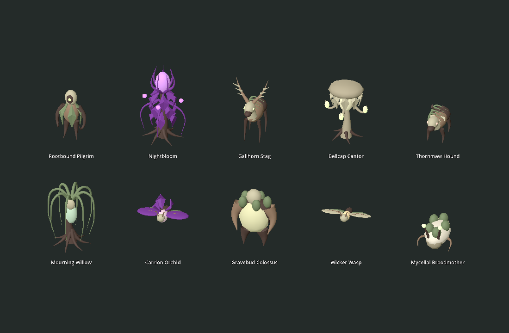
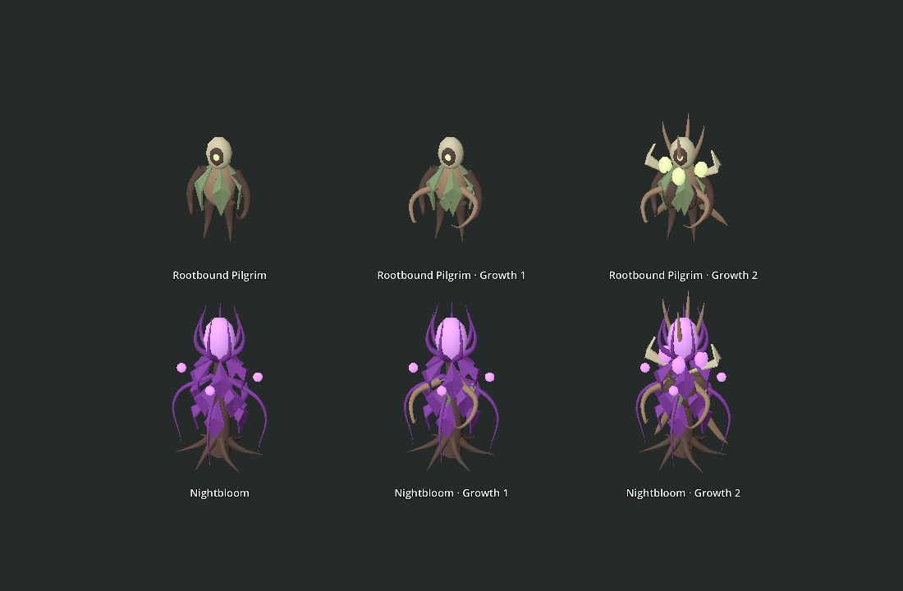

# Enemies of the corrupted network

Ten enemy templates now replace the old crab-like briar presentation in active encounters. The bestiary is available through Menu > Wilds bestiary.

| Enemy | Form and combat role |
| --- | --- |
| Rootbound Pilgrim | Upright hollow bark figure. Slow hooked-arm sweeps. |
| Nightbloom | Violet flower horror. Two separately telegraphed spore pulses. |
| Gallhorn Stag | Root-antlered, infected cervid. Locks a point before charging. |
| Bellcap Cantor | Walking fungal bell. Chants a temporary haste aura for nearby allies. Green warning rings show its non-damaging chant. |
| Thornmaw Hound | Vine-wrapped canine. Crouches and pounces at a marked location. |
| Mourning Willow | Draped root spirit. Ranged root eruptions briefly slow players they hit. |
| Carrion Orchid | Orchid-infested moth. Slow, broad, double-pulse artillery attacks. |
| Gravebud Colossus | Heavy bark-and-stone growth. Slow, wide stomps deal two base health points. |
| Wicker Wasp | Flying wicker parasite. Circles its target and darts into a quick sting. |
| Mycelial Broodmother | Fungal slug host. Can hatch at most two rootbound seedlings, using available encounter slots, then resorts to close attacks. |

## Shared production template

- Runtime definitions: assets/enemies/catalog.json.
- Shared Blender authoring kit: tools/enemy_model_template.py.
- Regenerator: tools/make_enemies.py.
- Editable Blender sources: assets/source/enemies/<id>.blend.
- Runtime models: assets/enemies/<id>.glb.
- Runtime selection and mutation rules: enemy_catalog.gd.
- Shared combat director: game.gd make_scout/update_scouts/resolve_scout.
- Shared presentation rig: stage.gd ensure_enemy/animate_enemy.

Each model exposes EnemyCore, optional animation pivots Root0..5, Growth1, Growth2, AdaptReach, AdaptBark, AdaptSpore, and AdaptMobility. Static geometry is combined inside each socket to reduce draw calls. Base forms have distinct silhouettes rather than one creature with different colors.

To add a related enemy, copy a catalog entry and give it a unique id and name. Keep a supported form and role, then adjust core/glow colors, speed, hp bonus, attack radius, range, windup, recovery, damage, biome list, and encounter unlock. Optional proportions [width, depth, height] and root_thickness change the generated geometry while preserving the rig. New anatomical families can use the existing blob, vine, petal, and radial-root helpers to add a form branch. New abilities can extend the director's role handlers.

From the project folder, regenerate everything with:
    & "C:/Program Files/Blender Foundation/Blender 5.2/blender.exe" -b --python tools/make_enemies.py

Regenerate one family with:
    & "C:/Program Files/Blender Foundation/Blender 5.2/blender.exe" -b --python tools/make_enemies.py -- nightbloom

Reload the game after catalog edits and let Godot reimport changed GLBs. The current compact species codec supports 16 kinds; extend it before adding a seventeenth. The generator validates unique ids and supported forms. Socket groups remain separate in Blender so an artist can edit each adaptation.

## Visible growth and behavior

Growth tiers are base, older, and advanced. Later encounters and difficulty cycles increase the tier; ordinary encounters 8 and 15 are the first tier changes in a fresh cycle. Extra foliage and crowns accompany small scale and health increases.

Mutation features are independent of growth tier:
- Extended tendrils increase melee reach or projectile acquisition range.
- Layered bark subtracts one point from incoming strikes, with a minimum of one damage.
- Enlarged spore sacs increase attack/aura radius.
- Mobility frills and roots improve movement speed and permit a telegraphed vault across static cover.

Vaults require a clear landing and continuous walkable floor underneath. They cannot cross forest boundaries. Their landing circle is visible before movement. Enemy models, growth tiers, mutation masks, and leader vault targets are synchronized to the guest. Brood spawns never exceed eight support enemies, and hatching avoids spawning directly on the player.

The last column demonstrates combined mutations for comparison; actual encounter selection does not grant every mutation to every enemy.

## Host-world adaptation

Adaptation currently uses persistent, rule-based tactic tracking:
- Repeated distant-damage clears build reach pressure.
- Repeated high-damage strikes (at least three raw damage, twice in a cleared encounter) build bark pressure.
- At least three kills in narrow floor passages during a cleared encounter build mobility pressure.

Pressures are capped, saved with the host Garden, and decay slowly after tactics are abandoned. The opening encounter remains unadapted. Most new mutation masks begin from encounter three; the established long-reach response can emerge in the second encounter of a repeatedly ranged host world. Starting at encounter ten, repeated tactics can accelerate adaptation within that same expedition. Older enemies can also develop an affinity-based mutation without player pressure, allowing the Wilds to progress on its own.

This is a deterministic adaptation director, not a trained neural network. The mutation-selection function is the replacement point for a future learned policy. The saved tactic counters are world-specific; they do not follow a guest character into another host's Garden.

All basic enemy attacks use one health point (half a heart), except the Colossus's two-point stomp. Existing later-cycle damage scaling is preserved. Telegraphs use each enemy's actual attack radius, and dangerous impacts remain visible within the player's current sight even if the attacker is outside it.

## Validation

tests/enemy_roster.gd covers all ten templates and roles, socket visibility, biome selection, host-memory persistence/decay, armor, snares, volleys, ally buffs, finite brood, and cover vaults. The playable solo/host/guest checks include evolved-species metadata synchronization. The campaign combat bot uses actual catalog attack radii and excludes the Cantor's harmless chant from its danger avoidance.

Validation completed: ten-template behavior and morphology checks, actual director updates for every role, slow-decay host memory, within-run deep adaptation, solo/host/guest regression checks with evolved-species synchronization, and a live combat-bot run through the Grove followed by extraction at encounter ten. Rendered previews include the roster, growth comparison, an evolved encounter, and the in-game bestiary.
