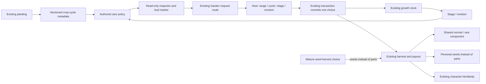

# Garden crop care — G-04

Implemented 2026-11-10. This is the first bounded cultivation choice; it reuses all existing species, components, harvesting, flowering and character familiarity.

## Player-facing rules

Interact with an immature crop to inspect its stage and expected remaining time. At the **young** stage, a small pale bud signals one optional choice:

| Choice | Time | Harvest |
|---|---|---|
| Ignore it / let it grow normally | Existing growth duration | One guaranteed shared ordinary part, plus the existing familiarity-based rare chance |
| Preserve the unusual bud | Adds 20% of the species' base growth duration, adjusted by the existing Garden growth multiplier | Same ordinary guarantee; rare-part chance increases by 15 percentage points, capped at 60% |
| Harvest seeds, once researched | Uses the same mature plant; no restart or second growth cycle | Two personal seeds; no parts, rare roll or preservation bonus |

Preservation can only be chosen before maturity and only once per crop. For a basic 5-minute species, preservation adds 1 minute of work before growth bonuses. Tier timing, Wilds acceleration and watering are defined in [Cultivation growth](CULTIVATION_GROWTH.md). A player can leave the inspector without choosing; the plant still matures normally. Explicitly choosing normal growth dismisses that crop's opportunity. At maturity, seed harvesting remains available instead of parts and forfeits the preservation bonus.

The crop and care choice belong to the host's Garden. Another player may inspect or harvest it. Rare chance is calculated from the **harvesting character's** current familiarity, as before; the inspector shows that viewer's chance. Care itself grants no familiarity, class XP, Knowledge or items. Harvest retains the existing familiarity amount, including existing nursery/class bonuses. There is no watering meter, crop death, new currency or mandatory daily maintenance.

Mature crops retain quick interaction harvesting. An inspector left open updates to show the harvest button when ready. The normal flowering key submits the same versioned crop intent as the inspector. The legacy flowering action now routes to an atomic mature seed harvest; it no longer resets age or starts a seed-growing mode.

## Reusable boundaries

- `garden_crop_catalog.gd` defines stable opportunity IDs and bounded numeric policy fields. The initial `patient_bud` appears at stage 2, adds `.20` growth work, and adds `.15` rare chance with a `.60` cap. No weapon-specific or species-specific effect handlers were introduced.
- `garden_crop_state.gd` owns pure policy access and mutation of a small `bed.care` dictionary: version, opaque cycle ID, stable species ID, opportunity ID, revision, choice and (when preserved) a frozen outcome roll. Planting creates a fresh cycle even for the same species. A committed choice and subsequent stage transitions advance the revision. The choice is its bounded receipt; there is no growing per-click reward ledger.
- `garden_crop_service.gd` validates a registered actor in the Garden, exact bed ID, range, current cycle, current stage/revision and allowed action. Same-choice retries return unchanged. Contradictory choices, delayed requests after replanting, out-of-range intents and Wilds actors fail safely. A pending travel transition also prevents tending. The service publishes a read-only per-viewer cultivation projection through the existing Garden detail route. It excludes the frozen roll and publishes no bed data while that viewer is in the Wilds.
- `garden_crop_view.gd` owns the inspector, intent construction and small cosmetic bud markers. The model and pulse do not affect growth or consume RNG. Existing root/HUD styles, species icons and component names are reused. Motion preference disables the marker pulse while retaining its static cue. Care metadata does not force the normal crop mesh or the Garden scenery to rebuild.
- `progress.gd` still owns the clock, ages, stage calculation and disk serialization. Only maturity duration is extended; sprout/young thresholds retain their original timing. Metadata survives the existing `plots_v2` save field. Legacy planted crops receive a cycle without losing completed growth; the obsolete flowering mode becomes a harvest choice; future care versions/unknown fields are retained without executing unsupported policy.
- `game.gd` retains planting stock consumption, the sole harvest payout, flowering, familiarity and class bonuses. Small mapped adapters initialize a cycle, open inspection for immature crops, choose seed harvesting instead of material payout and apply the policy to its one existing rare check.

The optional Garden projection does not add an RPC signature or compact snapshot field. The normal stage snapshot remains compatible; the host still owns all growth and payouts.

## Outcome and transaction limits

The preserved crop's roll is frozen when its choice commits, using a copy of the current RNG seed/state. It is stored as an integer in `[0, 999999]` to survive ConfigFile formatting exactly. That copy does not advance the gameplay RNG. A material harvest still consumes its one existing RNG draw; a preserved crop resolves its chance against its saved roll. Reopening the inspector, waiting, reconnecting or repeating a request cannot reroll the committed care outcome. The chance itself still reflects the actual harvesting character's familiarity.

The existing transaction commits the emptied bed, yields and character familiarity together. On failure it restores all of them; the harvest adapter also restores the RNG state. A failed care transaction restores its choice, revision and frozen roll. A seed harvest has no material roll. A successful harvest empties the bed, so simultaneous harvest requests cannot pay that cycle twice; a later replant has a different identity and rejects old versioned intents.

Diagnostics use the shared journal: `crop_care_chosen` and `crop_harvested` after successful commits, and `crop_request_rejected` for rejected requests. Fields include actor, bed, cycle, stable species, choice/revision or seed/part/rare outcome. No per-frame growth logging, character identity or pre-harvest roll is published.

## Extending content

1. Keep a new care outcome within an explicit time/yield budget. Start with another catalog policy and select its stable ID when the next crop cycle is created. Do not change the policy of an already chosen crop to reroll it.
2. Use existing species/part IDs. Ordinary yields, flowering exclusion and the sole harvest payout remain the contract. A new combat effect belongs in the existing component/tag system and requires its own integration coverage.
3. A future zone tool can select a policy for subsequent cycles. It must not rewrite current choices or add a second growth/research clock. G-07 remains the planned owner of that tool/configuration.
4. Register the actual consumers under `garden_care` in `tools/test_map.json`; preview the plan and keep unchanged evidence. The first policy is tested against all 24 existing species, including their rare-component mapping.

## Acceptance evidence

`garden_crop_care` covers real planting/inspection, exact previews, stage/range/mode checks, idempotent choice, normal versus delayed maturation, hidden frozen outcomes, save/reload, multi-file failure and RNG rollback, single material/rare/familiarity payout, same-species replant rejection, flowering cancellation and seed-only payout, legacy/future metadata and all-species policy reuse.

`garden_crop_care_coop` uses real peers for competing choices, private previews, shared state, reconnect, simultaneous harvest, exactly one familiarity reward and delayed intent rejection after replanting. Existing cultivation, species, inventory, research, observation and expansion-scene consumers are checked through the interaction map. The inspector and bud were rendered and visually reviewed at the game's current viewport size.

Runtime/package evidence and the installed EXE identity are appended to the milestone log after export. G-05 is the next mechanical objective; the retained cleanup backup remains outside routine work.

## G-04 release evidence — 2026-11-10T13:59:12-05:00

Completed optional crop care with a data-defined young-bud policy, saved crop-cycle identities/revisions, a versioned inspector, a cosmetic bud marker, delayed maturation and existing normal/rare versus seed-only harvesting. Shared choices survive reconnect; competing care/harvest requests cannot stack outcomes or familiarity. The committed care roll is stored as an integer and remains private. Failure restores choice, bed, yield, profile and harvest RNG.

Runtime run `20261110-135401-f9e78d2f`: 16 affected suites executed, 74 reused, 90 registered; all 36 planner self-tests passed. Package: 12 selected checks, 45 reused, plus startup/catalog/exclusion and real host/three-guest connection checks. Full suite was not run. Only the highest EXE, `Mystical Garden v0.5.2.0.exe`, was updated; installed SHA256 `c643a12fe25b48ae9dad783fe29b33a5597a8f2dee2398dd6b289434d8aff041` matches the verified staged package.

Evidence: `.godot/g04-unit.log`, `.godot/g04-connected.log`, `.godot/g04-package.log`, `.godot/validation/runs/20261110-135401-f9e78d2f/`, `.godot/validation/last-package.json`. In-engine screenshots `.godot/g04-choice.png`, `.godot/g04-preserved.png` and `.godot/g04-bud.png` were reviewed. The retained pre-cleanup backup was not opened, scanned, hashed or modified. G-05 is next; G-06 remains In progress overall, with return-specific ecology still to do.
