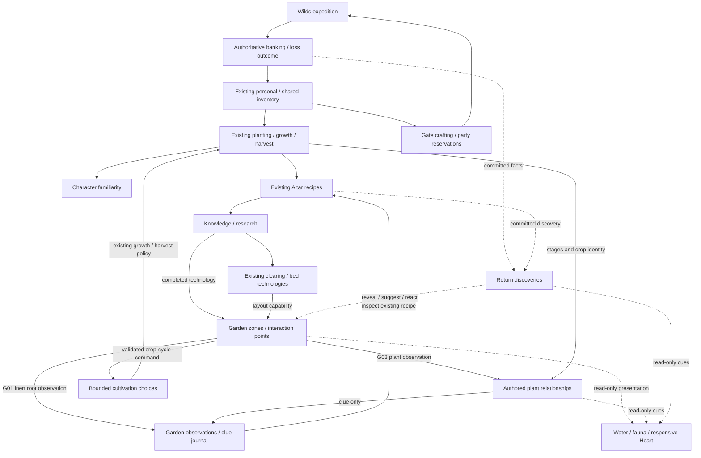

# Garden interaction development map

Updated: 2026-11-21 · Status: G-01 through G-07 implemented and packaged; G-08 Ready for pacing/economy/playtest review. The new canopy pass is source-only until separately promoted/exported.

Read [the milestone objectives](GARDEN_MILESTONES.md) for the next task and progress. The [mechanics/test map](MECHANICS_TEST_MAP.md) describes implemented systems; this document separates implemented observation/spring/relationship/cultivation boundaries from proposed later Garden mechanics. See [Garden observation authoring](GARDEN_INTERACTIONS.md) for the current modules, schema and evidence.

Base interaction text and prompt priority now live in `ui/gameplay/world_guidance.gd`, which takes detached display facts. Observation, crop/care, station, return, conduit and ambience views now receive detached frames through `garden_presentation_world.gd` and emit requests. Garden command integration now lives in `garden_commands_world.gd`; observation and conduit decisions accept explicit facts, and return discoveries use frozen character/run identities through `garden_return_service.gd`. Progress remains the saved-state owner; existing transaction services retain saving. The ordered effects/audio/map and plots/Heart/Garden display pipeline now lives in `world_presentation.gd`; it receives display facts, not Garden authority. These presentation extractions do not change the Garden milestone queue. The spring replacement is now implemented: Root Irrigation enables filling at the existing Garden water, without building a basin. `garden_water.gd` is the current source/bank query; cultivation keeps the existing vessel and crop transaction.

## Intended experience

Bring something home → notice a change → explore or cultivate a possibility → discover how to use it → test the result in the Wilds.

The Garden is a peaceful, living home with a quietly unsettling Heart. Progress should reveal places, capabilities and relationships, while preserving quick preparation for players who mainly enjoy combat. Optional investigation creates useful opportunities; essential maintenance does not become a party-wide chore. Knowledge and repeated expeditions should make the Garden visibly more interesting over a long campaign.

## Current behavior to preserve

These are implementation facts, not new feature promises.

| System | Current source/behavior | Direction |
|---|---|---|
| Cultivation | `progress.gd` owns beds with species, age, stages 0–3 and flowering; `garden_cultivation.gd` resolves native harvest and `garden_cultivation_world.gd` applies it through the existing transaction. Any identified species fits any bed. G-04 adds versioned crop identities and an optional young-bud choice. | Keep one growth clock and one harvest operation; see GARDEN_CROP_CARE.md for care costs and payout limits. |
| Plant materials | Harvest grants shared ordinary material and a familiarity-based rare chance. Flowering is an alternative mature harvest yielding two personal seeds instead of parts, without restarting growth. There are 24 species and 48 normal/rare plant components. | Preserve guaranteed baseline materials, existing item IDs and the parts-versus-seeds sacrifice. |
| Familiarity and class XP | Harvest currently awards personal species familiarity. Class XP comes from combat. | Add bounded care credit only through an explicit familiarity budget; no Garden class-XP loop. |
| Research | The host buys a technology at the Heart between expeditions. `heart_catalog.gd` defines prices and prerequisites. `heart_progress.gd` validates the purchase and applies the unlock immediately. | Shared material offerings award Knowledge and Growth Energy. |
| Expansion | Cultivation Grounds grants one stored bed. Further beds cost 12 Growth Energy. Reaching Roots unlocks paid frontiers. Structure instances and receipts live in `garden_structure_inventory.gd`, geometry and reachability in `garden_construction.gd`, and land in `garden_expansion.gd`. | Physical space, access and shared resources govern placement. See [HG02 construction](ARCHITECTURE.md#garden-construction-hg02). |
| Altar | `altar_service.gd` and `altar_recipes.gd` own identification, discovered recipes, seed combinations, component combinations and same-species refinement. | Garden discoveries supply clues to these recipes. Actual sacrifice and outputs remain at the Altar. |
| Garden stations | Reclamation and monster offerings require visiting their researched altars. The Living Archive displays guardian memory totals on-site. The Heart keeps the read-only Garden stories recap. | Reuse station positions, existing authority and proximity checks for new buildings. |
| Inventory | `inventory_model.gd` owns transfers; personal and shared storage are shown together by default. Shared seeds must be withdrawn for personal planting. | Every new cost names its storage source and uses this inventory path. No ecological currency/material bag. |
| Weapon preparation | `loadout_materials.gd` tracks personal-first/shared-remainder party reservations. Crafting happens at the gate; monster grafting happens at Wilds altars. | New parts use existing crafting/tag/card rules. Garden interactions must respect reserved components. |
| Travel and return | `party_travel.gd`, checkpoints and return code already own readiness, banking and loss. | Observe committed outcomes. Do not introduce free extraction, new checkpoint spacing or a mandatory Garden-ready checklist. |
| Visuals | `assets/terrain_m02/experimental/experiment_garden.gd` integrates generated ground, paths, water and construction; `garden_canopy.gd` presents two layers of complete crowns and grounded forest-edge trees. Tune the canopy in `garden_canopy_catalog.gd`, replace crowns under `assets/garden/canopy/`, and find source credits in `assets/source/ART_CREDITS.md`. `stage.gd` reads current placement for bed and altar interactions. | Render views do not own progression. Covered props retain collision/placement footprints without being drawn through the canopy. Construction reads detached thicket positions rather than wall meshes. The imported Heart replaces the old organ model; research growth modifies the imported stages. `garden_boundary.gd` rounds inward expansion seams without removing existing land. |
| Ownership/network | Host Garden owns Knowledge, technologies, recipes, beds and shared stores. Characters own class choices and familiarity. Guests have personal reserves within that host world. | Host validates mutations; guests send intent. Add one versioned Garden projection rather than per-feature RPC families. |
| Save/transaction/logging | `progress.gd`, `content_ids.gd`, `game_transaction.gd`, `save_batch.gd` and the diagnostic journal already provide persistence, identity and observation. | Extend them through one boundary. Logs and animation callbacks are never gameplay triggers. |

Crop growth now has its own shared 2× Wilds rate, composed with existing irrigation/nursery bonuses and optional once-per-crop 1.25× watering from a vessel filled at an actual generated-water bank. Tier base times are 5/12/25/50/90 minutes. See [Cultivation growth](CULTIVATION_GROWTH.md). Research unlocks immediately.

Walking collision is distinct from construction clearance. `terrain_actor_motion.gd` supplies shared tangent sliding to `garden_forest_barrier.gd` and `wilds_play_surface.gd`; straight dash sweeps remain separate. `terrain_prop_geometry.gd` shares the renderer's mesh/pose recipes and caches fitted walking outlines, including lower tree trunks and step-over stones at most 0.18 m tall. `garden_construction.gd::walking_footprint` projects station meshes without decorative bed shoots. Rectangular placement reservations, reclamation occupancy, saved terrain generation and door access reservations retain their existing behavior. Water remains blocking; TC01 projectile cover is unchanged. Walking-shape caches are derived geometry, not a second layout authority. See the movement boundary in [ARCHITECTURE.md](ARCHITECTURE.md) and `tests/terrain_actor_collision.gd`.

The historical `spring_water` and `spring_weave` observation markers no longer reserve construction space. Their `blocks_construction: false` declarations live in `garden_interaction_catalog.gd`; other landmarks remain protected by default. Scenery/generation exclusions and stable observation identities are retained for existing saved layouts, while filling still uses actual terrain water. The construction validator continues checking water, Heart base, physical structures and access. `garden_spring`, `garden_layout_persistence` and `experimental_terrain_coop` cover the freed site and its saved/networked relocation.

## Interaction and dependency graph

Solid connections below represent existing services. Dashed connections are proposed additions or adapters.



New systems read existing capabilities and submit explicit commands. They do not reach into combat, research or inventory internals to change unrelated state. A cosmetic moth reacting to a flower must not import the weapon-upgrade catalog.

## What overlaps, what replaces, and what stays separate

| Proposed feature | Reuse/overlap | Replace or retire | Boundary and risk |
|---|---|---|---|
| Garden water access (implemented) | Actual terrain pond and decorative-pool outlines, Reaching Roots and Root Irrigation | Dedicated spring model, watering-basin Build entry and placement gate are retired | Research enables dry-bank filling without a second payment. `garden_water.gd` validates current reach/support; `garden_cultivation_world.gd` applies the existing one-vessel operation. Historical observation IDs remain stable. |
| Ruined cultivation terrace | Later clearing technology, existing recipes and observation journal | No second crafting bench or breeding resolver | Exploration reveals evidence; Altar performs combinations. |
| Fungal hollow | Monster Studies and trophy offerings | No duplicate monster-donation economy | Initially a physical manifestation/view of the same service. Any new output needs a separately authored rule. |
| Plant relationships | Current species/tags, bed stages and existing refinement recipes | No second seed lineage tree or automatic crossbreeding | Start with a clue, not a permanent adjacency damage buff. Any species can still grow anywhere. |
| Tending and unusual buds | Existing growth stages, flowering and personal familiarity | No watering meter, crop-death maintenance or click-to-grow exploit | One meaningful decision per defined opportunity; bounded rewards. Baseline maturation continues unattended. |
| Return discoveries | Committed extraction/identification/research outcomes | No second expedition-completion counter | One run outcome cannot fire once per returning player or once per floor. Abandonment does not invent rewards. |
| Living water conduit (later utility) | Existing Heart research, zone conditions and bounded care outcomes | No new irrigation timer or resource currency | One researched tool selects a zone condition for the next crop cycle. It changes existing care opportunities, not weapon damage or universal planting eligibility. |
| Responsive Heart | Existing restoration phase and research completion | Only ambient presentation that currently ignores those events | No offshoot sacrifice score, morality system or finale activation. |
| Wildlife/water | Existing Garden rendering and safe scenery | Selected static decoration can become animated | Cosmetic local life has no hitboxes, loot, XP or gameplay authority. |

The old Pale Root, Lantern Bud, Hollow Seedling and Perfect Recollection ending remain deferred. Their saved records remain intact. Older `HEART_KNOWLEDGE.md` finale wording is historical; `campaign.gd::LEGACY_ENDING_ENABLED == false` and the current design brief establish the active rule.

## Small module boundaries

G-01 implements the catalog, dictionary-state helper, observe/inspect service, view and inventory-availability gateway below. G-02 adds the registered zone layout; G-03 adds plant conditions and existing recipe clues; G-04 adds garden_crop_catalog/state/service/view.gd around existing cultivation. Garden ambience and expansion scenes supply early G-06 presentation. Return adapters remain G-05. Extend the portion needed for each slice; do not reorganize the whole project first.

| Proposed module | Owns | May depend on | Must not own |
|---|---|---|---|
| `garden_interaction_catalog.gd` | Stable definitions for zones, points, actions, prerequisites and references | Content-ID validation | Mutable saves, arbitrary scripts or reward calculation |
| `garden_interaction_state.gd` | Pure normalization, transitions and receipts for a versioned Garden dictionary | Catalog IDs | Direct disk access or rendering |
| `garden_interaction_service.gd` | Host validation and a small action vocabulary: inspect, observe, choose care, acknowledge | Existing capabilities, inventory gateway, transactions, state helpers | Alternative plant/research/crafting implementations |
| `garden_layout.gd` | Zone footprints, paths, interaction anchors, bed-to-zone membership and camera extent | Existing Garden growth and bed adapters | Reward generation or runtime RNG from loot streams |
| `garden_presentation_world.gd` | Scoped Garden view frames and two intention routes; one weak world integration reference | Existing services, player/session observations and presentation Nodes | Garden/actor/inventory state, eligibility, costs or persistence authority |
| `garden_interaction_view.gd` | Scene instances, nearby prompts, cue playback and journal presentation | A read-only projected snapshot and existing visual builders | Item grants, research advancement or inferred discoveries |
| `garden_return_adapter.gd` | Translate committed run/identification/research outcomes into a bounded fact summary | Existing authoritative outcome code | Re-simulating loot, guessing seeds or maintaining a parallel run progression |
| `garden_inventory_gateway.gd` | Availability/cost plans for Garden actions, including party claims | `inventory_model.gd`, `loadout_materials.gd` | A second source of item counts or a separate reservation ledger |

Keep `game.gd` to a thin command route and composition call. Keep `stage.gd` to mounting the Garden layout/view. Avoid a generic global event bus, full ECS conversion or universal quest system for this work. A small typed set of committed Garden facts is enough.

### Expected cost of later changes

| Change | Expected implementation scope | Verification scope |
|---|---|---|
| Another clue with existing actions | Catalog entry, layout anchor, text/cue assets | Catalog validity and observation consumers |
| Another zone using existing capabilities | Zone definition, footprints and art; existing research references | Layout/unlock/late-join checks |
| New technology using an existing Garden capability | Heart catalog node and capability reference | Research completion and that capability's consumers |
| New care behavior using existing components | One care handler/outcome policy and its definition | Cultivation, item/familiarity budget and co-op receipts |
| New component with existing weapon tags | Existing seed/part/item/recipe authoring pipeline and assets | Content, crafting and relevant effect integration |
| New combat effect, save owner or network protocol | Deliberate service/contract change with explicit migration/compatibility | Wider affected interaction checks; treat as a major design decision |

The initial save/network adapter is shared boundary work and requires migration/compatibility evidence. Subsequent zones should not need fresh save fields or RPCs. Content edits still require normal Godot import/export; modularity reduces systems touched and tests invalidated, rather than promising partial EXE patching.

### Command and projection contract

Proposed request: action ID, interaction-point ID, expected state/crop revision, and a client request ID. Actor identity comes from the registered session peer, not the request body. This does not add account authentication or make the existing trusted character profiles cheat-proof. A normal command follows this sequence:

1. Validate point/action IDs, mode, player state, range, prerequisites and expected revision.
2. Resolve a typed inventory plan using stable item IDs, explicit ownership and unreserved quantities. Show the same plan in the preview.
3. Apply state and any inventory/research/character changes through the existing transaction boundary.
4. Commit, then publish the resulting revision, receipt and presentation cue. A rollback publishes no success animation or reward.
5. Reject duplicate/stale requests or return their existing result; never pay twice.

One command router and one versioned Garden projection should cover authored additions. Extend the existing detailed snapshot dictionary through an adapter; do not append fields into unrelated compact arrays in multiple locations. If compatibility requires a protocol revision, make that change once and test old-client rejection.

Clients must not infer a discovery from inventory differences, an animation finishing, a diagnostic log record or reconnecting to a scene.

### Save and ownership contract

Use one additive, versioned dictionary namespace in the host Garden, for example `garden_interactions`, with stable zone/point/observation IDs. A dictionary fits the current transaction snapshot's deep-copy behavior. A new RefCounted state object would need explicit serialize/restore integration like the Heart; it must not be assumed to roll back automatically.

Keep bed species/age/flowering in the current plot records. New interaction state refers to a stable bed ID mapped to the existing slot, plus a monotonically changing crop-cycle revision; it does not copy those fields. Keep Knowledge, item quantities and familiarity in their current owners. Add old-save defaults, normalization and preservation of unknown IDs. Completed technologies in an old save reveal their corresponding locations without another payment or an automatic duplicate reward.

One-off observation IDs can remain persisted. Crop-specific care receipts can be compacted when the crop cycle closes; old commands remain invalid because their crop revision is obsolete. Use a bounded recent presentation-event list. Do not save every creature movement, leaf animation or frame.

For new personal rewards, verify the existing host-commit/guest-character-publication/reconnect path. Separate host and guest files are not a distributed atomic transaction. Persist an authoritative receipt and reconcile its acknowledgement; do not promise exactly-once character XP merely because a single process's save succeeded. The first slice avoids adding a new personal reward path.

### Layout and input contract

Use authored zone footprints attached to the existing circular clearing, initially with fixed interaction anchors. The implemented spring associates the first two existing beds with its relationship zone without free beds or crop relocation. `garden_layout.gd` reserves water, tree, path, bed and interaction-clearance areas and registers the camera extent. G-02 water remains decorative and movement retains its existing circular boundary. Later physical shores/navigation must use these footprints through an authoritative movement adapter and matching guest prediction, rather than client-only collision. Decorative roots must not create invisible barriers across walkable paths.

Keep beds universal. A water-adjacent bed offers an opportunity, not permission to grow an otherwise forbidden species. Do not add free placement or a second terrain generator in this phase. Heart/Altar/gate menus remain canonical for their existing services; new local investigation points expose their own contextual actions rather than restoring retired global hotkeys.

## Reusable authoring example

This is a proposed schema illustration, not a file the current game can load:

```json
{
  "id": "spring_moss_observation",
  "zone_id": "sheltered_spring",
  "point_type": "plant_relationship",
  "requires_technologies": ["clearing_1", "irrigation"],
  "relationship": {
    "species_ids": ["lantern_moss", "whispervine"],
    "required_stage": "mature",
    "membership": "same_registered_zone"
  },
  "action": "observe",
  "hint_ref": {
    "resolver": "existing_refinement_recipe",
    "species_id": "lantern_moss"
  },
  "reward_policy": "record_clue_only",
  "repeat_policy": "once_per_host_garden",
  "cue_id": "moss_water_resonance"
}
```

Lantern Moss + Whispervine is a proposed relationship, not an existing breeding recipe. Resolve the referenced refinement recipe from the actual catalog; do not hard-code runtime part indices. The clue can suggest how to use two ordinary materials at the Altar. Observation does not mark the recipe discovered or grant a finished part. If players already know it, record the observation without duplicate Knowledge/item awards.

A later point using the same action/reward/cue vocabulary should need data, placement and art plus a content check. The proposed G-07 living water conduit makes this more than a physical menu reskin: a researched organic tool selects a zone condition for subsequent crop cycles, reusing G-04 care/outcome policies. Its two settings and costs are tuning decisions; changing a setting cannot reroll the current crop or pay out an item. A genuinely new verb/effect needs one handler and its consumers' tests. Data-driven does not mean arbitrary unimplemented strings become behavior.

## Return-event and co-op rules

Create a stable expedition-run ID at departure; combat epoch changes per encounter and is not a run identity. Produce one committed outcome summary from extraction/wipe/abandonment handling, with per-actor bank receipts where needed. Multiple players returning is one outcome, not multiple Garden advancement events.

Triggers may reference committed world discoveries, unlocked technologies or deliberately offered items. An unidentified seed's true species/rarity and another player's private stash remain concealed. Use a generic resonance before identification, or trigger the specific response after identification/explicit offering. No new grant can arise from abandoned loot. Existing safe-pouch recovery and research-time rules stay intact.

Any eligible player may inspect/reveal a paid-for location. Technology purchase and persistent zone-tool configuration remain host-controlled. Guests may inspect the current configuration and perform eligible care actions; per-zone permissions can be considered later. Shared observations belong to the Garden; personal familiarity belongs to the contributing character. Two players observing at once may both see the cue, but cannot duplicate a shared reward. Changing a crop, spending a previewed material or moving out of range makes an old request stale. A late join receives current state and a short recap, not every historic reward animation.

## Validation boundaries

Registered domains now include `garden_observations`, `garden_costs`, `garden_zones`, `garden_relationships` and `garden_life`. Registered focused suites include `garden_interactions`, `garden_interactions_coop`, `garden_spring` and `garden_spring_coop`, alongside affected existing consumers. `garden_care`, `cultivation_growth`, `garden_cinematics` and `garden_returns` now also have implemented modules and focused/real-peer suites. Future G-07 files remain unregistered until implemented.

| Change | Narrow proposed domain | Existing consumers to consult | New focused evidence |
|---|---|---|---|
| Zone placement/reveal | `garden_zones` | `garden_presentation`, `gardening`, `gate_garden_services`, `heart_progression` | Reachable anchors, overlap rejection, old-save revealed state, camera bounds |
| Observation/clues | `garden_observations` | `garden_altar`, `seed_progression`, `inventory_party` | Conditions, hidden IDs, known-recipe fallback, one-time recording |
| Care opportunity | `garden_care` | `gardening`, `species_depth`, `seed_inventory` | Crop-cycle receipts, guaranteed baseline, flowering exclusion, no click farming |
| Return facts | `garden_returns` | `run_flow`, `checkpoint_extraction`, `loot_revival`, `party_ready` | One party outcome, loss rules, reconnect/replay and late join |
| Inventory costs | Existing `items`/`weapons` adapters plus the changed Garden domain | `inventory_party`, `crafting_availability_coop`, `garden_altar`, `network_research_coop` | Preview/commit agreement, reservations and rollback |
| Cosmetic ecology | `garden_life` | `garden_presentation` | Visual preview, safe paths, population/performance bounds; no economy mutation |

Keep domains cohesive. A cosmetic creature change should not pull in weapon damage tests; a new care reward needs the inventory/familiarity consumers. Broad source smoke and release startup/network checks remain available through the established workflow. Full game-suite runs are reserved for major releases or an explicit user request.

## Primary risks to resolve first

- Shared material previews can disagree with party reservations unless the new gateway uses the same availability policy at preview and commit. Audit touched Altar/Heart offering paths instead of assuming they already honor every new claim.
- Current expansion is largely radius/scenery based; adding locations without one layout authority could reintroduce blocked paths, overlapping beds or an incorrectly bounded camera.
- New stage-based familiarity can inflate the current harvest reward if both are granted at full value. Establish a per-cycle budget before introducing it.
- Per-player return callbacks can duplicate world rewards; portable character publication needs explicit reconnect reconciliation.
- Mandatory optimal plant adjacency, exclusive climate beds or recurring chores could undermine both universal planting and fast party preparation. Start with optional clues and bounded opportunities.

Completed G-07 evidence and the next **G-08** objective are in [GARDEN_MILESTONES.md](GARDEN_MILESTONES.md). The committed bank/identify boundary and scene queue are implemented; use them for future content instead of paying rewards from animation callbacks.

Implemented references: [spring and animation guide](GARDEN_SPRING_LIFE.md), [bounded cultivation care](GARDEN_CROP_CARE.md). `garden_zones`, `garden_relationships`, `garden_life` and `garden_care` are registered domains with actual modules/tests. Water footprints currently reserve scenery/approach space; they add no blocking movement geometry. Research, inventory and harvest authority remain in their existing owners.

Confirming a frontier in Build commits its land, root and expansion scene together. Each viewer receives the expansion through the private Garden projection, follows the purchased root and acknowledges their own scene. Knowledge still changes the Heart’s permanent appearance and plays its research cue. Expedition return discoveries retain their own presentation. See the [growth scene guide](GARDEN_GROWTH_SCENES.md) and [return guide](GARDEN_RETURNS.md).

## Implemented return boundary (G-05/G-06)

Departure → host run ID/member receipts → existing bank/loss operations → host-world verified species credit → successful Altar identification → one saved discovery → existing growth scene queue/private projection → local trace/fauna/water/Heart response and bounded recap. Return callbacks grant nothing. A world-level species credit is intentionally fungible across personal/shared mystery stacks; it is not a per-item provenance system. The raw credit/member history stays private. G-07 should add one location using the layout catalog, then a conduit setting through the current research/care services, not a competing crop clock or project queue.

## G-07 repeatability proof

Verdant Refuge → catalog terrace/footprint/existing bed 4 → existing observation/Whispervine refinement clue → existing Altar. Root Irrigation + Verdant Refuge → Living Water Conduit in the existing Heart queue → host-only saved mode/revision → new crop-cycle snapshot → existing bounded preserve/leave, duration, rare roll and harvest. Configuration does not touch planted crops. The new handler owns only `configure_conduit`; ordinary inspection and recording still use the generic point handler. See [authoring/change audit](GARDEN_CONDUIT.md). A title-join regression exposed by connected checks was fixed at viewer registration: a guest has no local Garden to initialize/save.

G-07 is Complete. The next objective is G-08 in the canonical milestone queue. Preserve the authority boundaries and gather actual playtest observations before claiming pacing/enjoyment targets are met; Full validation is still an explicit major-release decision.

Garden layout policy (2026-11-21): construction layouts survive launches. Use Garden Development at the Heart → select Starting bed 1–3 or Garden Altar → Move selected structure. Crops stay with their stable bed slot. Only generated terrain water remains; Root Irrigation unlocks its existing vessel operation. Live placement stays in construction; ConfigFile data is a detached validated projection, committed with related progression through the existing save boundary. See the saved-Garden section in ARCHITECTURE.md for interfaces and focused tests.

Clarified Heart placement policy (2026-11-21): reserve the fully grown ground-level trunk/root base, not its canopy. `terrain_heart_preview.gd::maximum_base_outline` derives this from the imported model at maximum enabled research growth, using geometry between ground level and `BUILD_BASE_HEIGHT_M` (0.35 metres). Overhead branches and buried geometry add no exclusion; decorative reclamation roots outside the model add no independent barrier. Existing structures/crops remain in place. Water, obstruction, access and research rules still apply. `heart_build_reservation` verifies starter relocation and a newly researched bed beneath the canopy without expansion; saved-layout and terrain co-op fixtures protect persistence and multiplayer.
