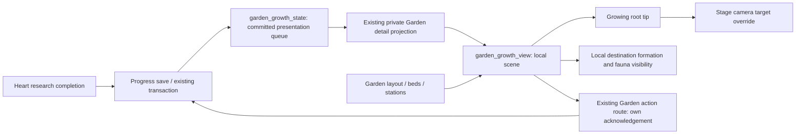

# Garden expansion scenes

Implemented 2026-11-10, as an incremental G-06 presentation slice. Research remains the authority for unlocks. G-04 care choices and G-05 return-discovery rewards are separate objectives.

## Player experience

A completed technology queues a short scene. After menus close in the Garden, the camera focuses on the Heart, follows the leading root from the Heart to the expansion, pauses while the destination forms, then eases back to the player. A pale growing tip stays readable through foreground scenery. Beds scale around their real planting position; the spring's water, banks and pads form together and its moths appear after arrival. Clearing reveals expand the ground; station unlocks reveal the existing station model. Other technologies use the Heart's pulse and existing development stages.

Research completed during a Wilds expedition waits until the party is back in the Garden and no ready-check transition is active. These are optional local scenes: each player can skip with Escape or the on-screen button. Settings → Display & aiming → Play Garden growth scenes disables them. Disabling Garden ambient motion also skips camera scenes. Progress and rewards are unaffected by watching or skipping. Normal HUD and local movement are suspended only during the shot; another player's skip does not dismiss your scene. Departure or disconnection interrupts without acknowledging, so an unwatched scene can be offered again.

Existing saves establish their current Garden as the baseline and do not replay historical unlocks. A new character visiting a developed Garden also starts from its current state. A returning character keeps its saved acknowledgements and pending scenes. The most recent 64 events are retained; exceptionally old unwatched scenes age out with that bounded history.

## Ownership and interaction map

- `garden_growth_catalog.gd` maps existing technology definitions to bed, clearing, station, spring or Heart reveals. Bed destinations derive from `plots`; station positions use `HEART_STATIONS`; springs use registered zone requirements and their inspection anchor.
- `garden_growth_state.gd` prepares an additive `garden_interactions.growth` dictionary. Preparing is pure. `progress.save_garden()` serializes the prepared state and publishes it only after a successful write; existing transaction snapshots restore it if the multi-file commit fails. Outer and nested future versions are preserved without execution.
- `garden_growth_service.gd` registers viewers by existing character identity and supplies only the current viewer's pending/history state. The existing reliable Garden dispatcher accepts `growth_ack:<sequence>` for that actor's first pending event; clients cannot acknowledge another player's scene or invent a later sequence. Identity keys remain on the host and are not sent in the projection or diagnostic events.
- `garden_growth_view.gd` owns the letterbox, skip control, root mesh, visibility masks and temporary camera metadata. It never grants items, spends Knowledge, completes research or moves a player. The host's ready/expedition state gates playback; a local interrupted view releases its camera/input/UI state.
- `stage.gd` consumes the optional local camera target in its existing focus method. During travel along the root, this target is the root's current tip, rather than the final location. The normal Garden camera bounds resume afterward. Plot/pond groups preserve world positions and permit formation around their own origin. Root/path meshes carry destination metadata for hiding pending routes.
- `garden_ambience.gd` observes the camera during a spring reveal and suppresses unrevealed colonies. Wind/water/moth transforms remain cosmetic; no extra RNG or replicated motion is added.

No new RPC signature, compact combat slot, research payment, garden capability or deferred finale behavior was introduced. Shared simulation continues while a player watches. The scene is not a multiplayer lock or a reward receipt.

## Adding another expansion

1. Add the actual capability through the existing Heart catalog and its owning mechanic; verify that research and persistence work first.
2. Prefer catalog metadata already supported by the reveal mapper. Register a new physical destination in the Garden layout rather than putting world coordinates in the dispatcher. A new spring-like zone needs its normal `requires`, water and inspection-point definitions.
3. Extend the small reveal mapper/view only when a new presentation kind is necessary. Keep interaction/reward authority in the existing service. New visual groups should carry a stable destination and preserve local/world transforms.
4. Register coverage in `tools/test_map.json` under `garden_cinematics` and any actual consumers. Preview the selected plan. A scene-only change does not require the full gameplay suite.

## Verification

`garden_growth` covers additive save migration, pure preparation, duplicate saves, write and multi-file rollback, expedition/travel deferral, forged acknowledgements, new/returning viewers, root-tip camera motion, in-place bed/spring formation, interruption/skip, disabled scenes, bounded history and future schema preservation. `garden_growth_coop` uses real host/guest peers to verify private projection, independent skip, shared unlocks and reconnecting with an unwatched scene.

Existing Garden, observation, research, settings, travel and solo suites cover the changed consumers. The solo smoke's old familiarity assertion assumed a randomly selected species had already been killed; it now measures the actual encountered species' before/after count for the deliberately isolated kill. Gameplay reward rules were not changed.

Engine-rendered bed/root and spring formation previews were inspected under the Compatibility renderer. Diagnostics record `growth_scene_started`, `growth_scene_finished` and post-commit `growth_acknowledged`, using sequence/technology/kind/actor fields and no character identity or frame-by-frame motion logging.

Release evidence is recorded in the milestone implementation log after validation/export. The protected pre-cleanup backup remains outside all work and validation.

## Release evidence — 2026-11-10T13:34:08-05:00

G-06 presentation slice is implemented and packaged: Heart focus/pulse → camera follows the growing root tip → bed, spring or station forms (or ground expands) → smooth return. The queue survives save/rejoin; each viewer can skip independently. Research completed in the Wilds waits for return. A guest leaving mid-scene cancels the old host's camera without acknowledging anything in their local Garden. Scenes can be disabled in Settings and also respect the Garden motion preference. Existing saves do not replay historical unlocks.

Final runtime run `20261110-133055-638c81b1`: 17 affected suites executed, 71 reused, 88 registered. All 36 planner self-tests passed. Packaged checks: 12 selected, 43 reused, plus startup/catalog/exclusion and real host/three-guest connection checks. Full validation was not run. The final installed `Mystical Garden v0.5.2.0.exe` matches staged SHA256 `60b8f8458e169462a8dd31a87705a8a13814c038bf733ede631267d7aee581d2`.

Evidence: `.godot/growth-connected-context.log`, `.godot/growth-package-final.log`, `.godot/validation/runs/20261110-133055-638c81b1/`, `.godot/validation/last-package.json`; inspected rendered frames `.godot/growth-bed-1.png` and `.godot/growth-spring-2.png`. G-06 remains In progress overall; G-04 is the next mechanical objective, and G-05 discovery rewards remain planned. The retained pre-cleanup backup was not opened, scanned, hashed or modified.
