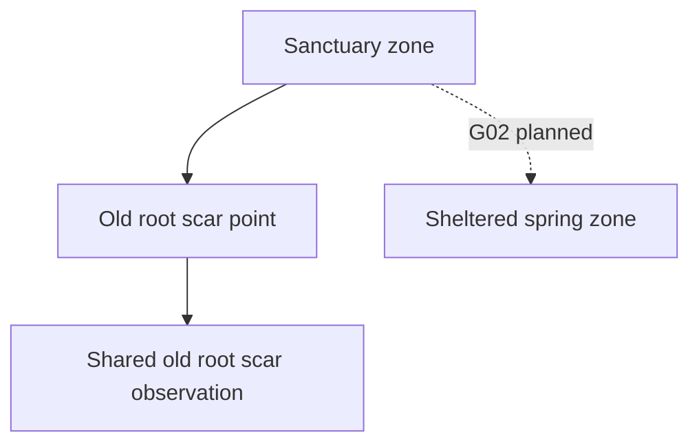

# Garden observation system and authoring

G-01 completed 2026-11-10. Walk to the small root scar below and left of the Heart, follow its short path, and press the configured Interact key (E by default). The inspect panel lets a player record the trace in this Garden's shared journal. Re-inspecting shows the saved observation. It grants no item, Knowledge, class XP or technology.

## A location tree and a system graph

The existing mechanics map describes shared dependencies and integrations. Keep it as a graph: inventory, cultivation, crafting and expeditions form a gameplay loop, and several systems share the same authority. Turning it into a strict tree would duplicate those authorities or hide cross-links.

Garden content has its own parent/child hierarchy. G-01 began with one root zone, `sanctuary`, and one child point, `heart_root_scar`. G-02/G-03 now add the spring and a mature-plant relationship; see [current extension and animation guide](GARDEN_SPRING_LIFE.md). Zones inherit technology prerequisites from parent zones; points may add their own requirements. Catalog validation rejects unknown parents, cycles, duplicate point/observation IDs and unsupported actions/cues. The spring uses this same service as another child zone.

Runtime/test ownership remains in `tools/test_map.json`; its generated view is [MECHANICS_TEST_MAP.md](MECHANICS_TEST_MAP.md). `garden_observations` owns the catalog, state, command/projection service and view. `garden_costs` owns the reservation-aware availability adapter. These domains connect to existing persistence, research capabilities, presentation, inventory and weapon claims. The graph explains integration; it does not recursively invalidate every connected system when one point's text changes.

## Current module boundaries

| Module | Responsibility |
|---|---|
| `garden_interaction_catalog.gd` | Stable zone/point/observation IDs, parentage, anchors, inherited technology prerequisites, text, supported action/cue and catalog signature |
| `garden_interaction_state.gd` | Schema 1 normalization, durable observations, monotonically increasing revision and bounded recent request receipts |
| `garden_interaction_service.gd` | Host-side actor/mode/range/revision checks, inspection focus, idempotent observe command, transaction commit and read-only projection |
| `garden_interaction_view.gd` | Root-scar mesh through the existing root tube/bark shader, nearby label, inspect panel, intent submission and post-commit pulse |
| `garden_inventory_gateway.gd` | Aggregate explicit offering costs against existing personal/shared inventory and party weapon claims |

`progress.gd` holds one additive `garden_interactions` dictionary and persists it in its own ConfigFile section. Existing `game_transaction.gd` deep-copy/rollback covers that dictionary. `game.gd` contains narrow wiring hooks rather than another Garden implementation. `garden_visuals.gd` adds eligible point anchors to its existing paths and grass-clearance pass. G-02 now provides zone footprints and spring/bed membership through garden_layout.gd. Return adapters remain later work.

## Commands and synchronization

Commands use the existing reliable Garden request route: `garden:` followed by an object containing `point`, `action`, `revision` and `request`. The supported actions are `inspect` and `observe`. Actor identity comes from the admitted peer. A request cannot grant resources or supply a different actor.

The host checks registration, Garden/alive state, point/action IDs, inherited technology eligibility, range and expected revision. A stable character identity plus the request ID identifies a retry. A recorded observation remains one-time even after the bounded receipt window is compacted. Concurrent requests with revision zero can produce only one revision-one discovery. The transaction commits the world save before success feedback and its diagnostic event are emitted. A failed save restores state/receipts and produces no success pulse.

The projection is an optional schema-1 dictionary in the existing owner detail snapshot, not a new RPC family or an extension to compact combat arrays. It contains available point IDs, known observations, revision, latest committed observation and that viewer's inspection focus. A content signature prevents mismatched catalogs from exposing incompatible anchors. Absent/foreign projections hide this optional feature; no RPC signature or protocol revision was necessary. Everyone should still use the updated executable when playing the milestone together.

Only the shared journal is persisted. Panel focus and presentation epoch are transient. Joining/rejoining a world establishes a new cue baseline; it restores the shared observation without replaying a historical pulse or reopening another player's panel. Presentation never spends items, advances research or marks a discovery by itself.

Unknown saved IDs and fields survive normalization and roundtrip. A future schema is preserved and fails closed for mutations. Old saves default to a blank observation dictionary; the existing beds, stock, recipes, character progression and research remain under their original owners.

## Offering availability without a second inventory

`garden_inventory_gateway.gd::plan` accepts a list of stable item IDs, explicit `stash`/`shared` sources and positive integer quantities. It aggregates repeated ingredients and reads current stock from `inventory_model.gd`. Personal and shared material availability subtracts the same prepared-weapon/cargo claims used by `loadout_materials.gd`.

The touched consumer is the Garden Altar preview. Its existing combine operation still validates again and consumes through protected `InventoryModel.take` inside its existing transaction. No second quantities store, reservation ledger, offering currency or reward resolver was added. Clearing gate selections immediately frees the associated components for the preview. Future care/offering consumers should use this same preview contract and the established transactional payment path.

## Add another observation point

1. Append a unique stable zone ID to `ZONES` if a new parent is needed. Give it an existing parent or the empty root parent and valid Heart technology IDs. Published IDs must not be reused.
2. Append a point to `POINTS`: unique `id` and `observation`, known zone `parent`, `position`, interaction `range`, `requires`, `name`, `description`, `recorded`, `hint`, and the existing `observe`/`quiet_pulse` vocabulary.
3. Place its anchor in safe reachable Garden ground, away from stations, beds and ponds. Current observation anchors feed existing paths/groundcover clearance. New zones with water, camera changes or bed relationships use the implemented `garden_layout.gd` boundary. Physical collision/prediction changes need their own authoritative integration.
4. The existing nearest-point resolver, host handler, save dictionary, projection, inspect view and pulse handle the point. A second data-only definition is validated and recorded by the focused test; no new command, save field or RPC is needed.
5. Preview the dependency-selected checks. Run the Garden observation/catalog consumers and any newly touched layout, cost or reward consumers. A new verb/effect needs an implemented handler and its integration checks; adding an arbitrary string does not create behavior.

## Verification and milestone evidence

Initial integration ran 13 affected source suites with 71 unaffected results reused. After the rendering/lifecycle refinements, runtime run `20261110-115117-54961588` passed 9 affected suites with 75 reused. Final map certification `20261110-115307-f172bb17` reused all 84 verified suites. All 36 planner self-tests passed. No full game-suite run was completed for this routine milestone.

Packaged validation selected 8 suites and reused 43, plus the exporter startup/catalog/exclusion checks and real host/three-guest network smoke. Both new Garden suites passed against compiled exported scripts. The installed `Mystical Garden v0.5.2.0.exe` matches the verified package SHA256 `e5f67a8bfbc1ee5c930e58ced0f4e09ea37c611c0d2dda4fe61ee21d57465cfb`.

The first final-plan attempt expanded because a helper rewrote dispatcher line endings. That run was stopped and the original LF encoding restored. Its cache-index invalidation was recovered from the previous verified release certification using unchanged original keys, the same engine and verified original log hashes. Canceled-run results were not promoted; `.godot/g01-cache-recovery.json` records the provenance. Multi-line additive-region tests now preserve existing region positions and reject missing adapters; relationship tests reject malformed dependency edges.

Evidence: `.godot/g01-unit.log`, `.godot/g01-connected.log`, `.godot/g01-connected-final.log`, `.godot/g01-final-certification.log`, `.godot/g01-package.log`, `.godot/validation/runs/`, `.godot/validation/last-package.json`. Rendered checks: `.godot/g01-garden-point.png`, `.godot/g01-inspection.png`, `.godot/g01-recorded.png`; render error log is empty.

The retained November 10 cleanup backup was not opened, scanned, hashed or modified. Normal staged-build backups remain separate from that protected checkpoint. The spring/relationship extension is now implemented; next objective: **G-04**, one bounded crop-cycle choice. See GARDEN_SPRING_LIFE.md for current evidence.
