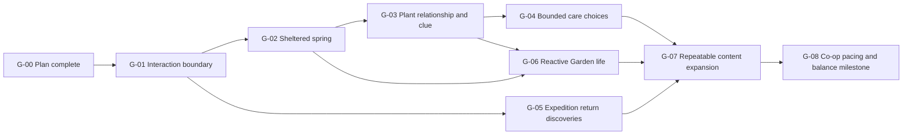

# Garden milestones and objective design

Updated: 2026-11-21 · Owner: shared between the user and development assistant.

Architecture and overlap decisions: [Garden development map](GARDEN_DEVELOPMENT_MAP.md). Implemented test ownership: [mechanics/test map](MECHANICS_TEST_MAP.md). Existing product intent: [design brief](../DESIGN_BRIEF.md). This document holds the Garden work queue and the [Wilds enemy](#wilds-enemy-design-milestones), [Core combat](#core-combat-milestones), [sound design](#sound-design-milestones), and [combat balance and vitals](COMBAT_BALANCE_MILESTONES.md) milestones.

## Current handoff

| Field | Value |
|---|---|
| Recent work | The Garden pass through `5fdd294` is integrated into main. Character customization is committed at `e017e88`; `art/weapon-animation-pass` builds on it with raised Focus, nine imported upper-body clips and alternating sword/knife strikes. Follow-up corrections restore neutral omitted animation tracks, relaxed carry, a level side-on spear thrust, lateral bow draw, downward scythe blade and forward utility sweeps. Full-cycle visual review and focused verification cover both bodies and local co-op; subjective motion remains in the playtest queue. Garden/Wilds sliding, saved placement, water and Heart-base protections remain intact. Main, Playtest 9, protected tags and real saves are preserved; evidence is recorded in ARCHITECTURE.md. |
| HG04 localized cultivation | Six structure types support independent strength and coverage upgrades, configurable bud care, starting propagation and Seed Conservation. Next is manual layout and balance playtesting. [Rules and prices](SEED_PROGRESSION.md#local-cultivation-tuning-hg04). |
| HG03 living infrastructure | Automatic roots, shoreline intake, local sprinkler coverage and starting manual watering are implemented. Next is visual and spacing playtesting with the Build preview. [Editing paths](ARCHITECTURE.md#living-garden-infrastructure-hg03). |
| HG02 construction | Build manages Inventory, Construct and Placed. The next Garden check is a manual walk through compact beds, station approaches and reclaimed frontiers. [Editing paths and migration](ARCHITECTURE.md#garden-construction-hg02). |
| HG01 research foundation | On the WF02 development line, explicit Heart purchases unlock immediately and material contributions pay both currencies. The full Knowledge catalog redesign remains a separate milestone. See [Heart research and offerings](ARCHITECTURE.md#heart-research-and-offerings-hg01). |
| Botanical development branch | WF02 builds on WF01 with five exploration founders and depth-correct Ancient seeds. Next botanical step is manual playtesting of natural placement, readability and founder availability. See [botanical progression](SEED_PROGRESSION.md). |
| Next combat objective | **CB-08 · Live playtest and release.** Compare pacing and sustain in solo and co-op, apply any tuning, then promote the verified balance. [Combat balance catalogue](COMBAT_BALANCE_MILESTONES.md#live-playtest). |
| Next player-facing milestone | Review male/female customization and the weapon-presentation pass: elevated Seed Focus carry, forward weapon stances, corrected striking planes, alternating sword/knife attacks, bow draw and bell/censer/fan sweeps. Lower-body idle/walk/run and gameplay contact timing stay unchanged. Continue reviewing building on former spring ground, saved layouts, water and edge sliding. G-08 pacing/listening review remains open. Source work is separate from the installed playtest. |
| Project state | G-00–G-07 and W-00–W-07 are complete. G-08, W-08 and C-07 remain in the playtest queue. |
| Listening review | Use A-06 to gather human feedback on cue recognition, mix balance and listening fatigue. The same sessions can cover the existing Garden and Wilds playtest milestones. |

### Knowledge tree review and expansion playback

The tree includes the starting Heart and one bed-construction unlock. Research updates the Heart. The expansion cutscene now belongs to the frontier purchase in Build. See [Garden expansion scenes](GARDEN_GROWTH_SCENES.md).

| Nodes | Current gameplay payoff |
|---|---|
| Sheltered Heart, Cultivation Grounds | The starting Heart is the prerequisite. Spending four Knowledge grants a stored bed and enables repeatable bed construction. |
| Reaching Roots, Verdant Refuge, Living Sanctuary | Unlock repeatable frontier purchases, then discount their growth-energy cost by 10% and 20% from the first tier. Verdant Refuge also unlocks the cultivation terrace. |
| Flowering, Root Irrigation, Symbiotic Nursery | Harvest mature plants for seeds, fill a vessel at terrain water, grow crops faster and earn additional familiarity. |
| Reclamation Altar, Offering Altar | Build the corresponding station to reclaim discovered seeds or exchange trophies for Knowledge. Modern graft purchases have no Offering Altar chance bonus. |
| Trophy Preservation, Returning Mycelium | Increase expedition monster-part cargo from six to eight, or send one eligible item home per player at a cleared third gate. |
| Living Water Conduit | The host selects the bud policy for future crops in Bed 4. The benefit follows the bed identity when moved. |
| Living Archive and three Remembrances | The Archive tracks guardian memories. The three thresholds are 12, 16 and 20. They record progress and the Archive contributes to the Heart’s late visual phase. |

Current saves omit the former finale and offshoots. On loading an older Garden, the Heart releases up to six Knowledge for paid Rift Resonance and up to twelve for paid Perfect Recollection, while preserving spending on supported research. Existing guardian memories and earned research remain available.

Living Archive and the three Remembrances are under design review. They still record guardian progress. One possible replacement would use the Archive to open a final expedition route, with the fight before extraction while the party still has its cards and grafts. That route has not been approved or implemented.

## Rules for continuing and editing

1. Read this handoff and the dependency map before coding. Re-check current source at the touched boundary; older screenshots/notes are historical evidence, not authority over current mechanics.
2. Keep milestone IDs stable. Use Proposed, Ready, In progress, Review, Complete, Blocked or Deferred. Mark Complete only after its acceptance evidence is recorded.
3. Default work proceeds in dependency order. An isolated visual task may run alongside a later mechanical milestone only when it does not require unfinished state/economy contracts.
4. Content and tuning below are proposed defaults. Record material changes in the decision log. Escalate major direction choices such as changing ownership, baseline crop loss, universal beds or Knowledge currency; resolve routine layout/art choices within the established intent.
5. After implementation, update statuses, evidence, affected mechanics/tests, changed files and the handoff's next objective. Add runtime files/tests to `tools/test_map.json`, then regenerate its readable map.
6. Preview test selection. Run affected suites and related integration/co-op checks; reuse valid unaffected results. Full runs are for major releases or explicit requests. Documentation-only edits need no game tests or EXE rebuild.
7. When exporting playable work, discover and replace only the highest revision EXE with backup. Do not rename a revision milestone on the user's behalf.

## Dependency and scope overview



| ID | State | Observable objective | Depends on | Size of intended slice |
|---|---|---|---|---|
| G-00 | Complete | A shared map and editable queue describe existing overlaps and safe additions | — | Planning only |
| G-01 | Complete | One host-authoritative observation survives save/rejoin and rejects duplicates | G-00 | One interaction, one state boundary, no new economy |
| G-02 | Complete | Existing Knowledge enables accessible, inspectable Garden water; the former spring fixture is retired | G-01 | One water-access contract; reuse actual pond/pool geometry |
| G-03 | Complete | Plants reveal a clue that leads to an existing useful Altar recipe | G-02 | One relationship and one clue |
| G-04 | Complete | A crop offers a meaningful, bounded nurturing/sacrifice choice | G-03 | One care opportunity and one outcome policy |
| G-05 | Complete | Returning from an expedition can cause a persistent Garden discovery | G-01; play it after G-03 | One trigger and one return scene |
| G-06 | Complete | A small amount of life reacts to those discoveries and cultivation | G-02, G-03 | One fauna family, one water response, one Heart response |
| G-07 | Complete | A second location and a useful Garden tool work through the same templates | G-04, G-05, G-06 | Prove repeatability before adding a large content list |
| G-08 | Ready | The Garden supports both short preparation and optional investigation in co-op | G-07 | Integration, pacing and economy review; major-release candidate |

## G-00 — Shared direction and source audit

**State: Complete (2026-11-10).**

Deliverables: `GARDEN_DEVELOPMENT_MAP.md` and this document. Current cultivation, Heart research, Altar refinement, storage/claims, travel and rendering were inspected. The plan explicitly preserves the deferred finale and separates current mechanics from proposals. No runtime feature was added.

Evidence: documentation cross-links, milestone-ID consistency and source-reference review. Game tests and EXE replacement are not applicable.

## G-01 — Small interaction boundary

**State: Complete (2026-11-10).** Objective: prove the pattern with one inert observation point before a new location, reward loop or large content catalog.

Work:

- [x] Define stable point/action/observation IDs and validate one tiny catalog.
- [x] Add an additive, versioned Garden dictionary and old-save defaults. Reuse transaction deep-copy/rollback rather than introducing an unsnapshotted state object.
- [x] Route one inspect/observe request through a small Garden service: actor, range, revision and duplicate checks.
- [x] Publish one read-only projection and a post-commit cue through adapters to existing network/presentation infrastructure.
- [x] Provide a minimal observation entry/inspect view. It records a discovery but grants no new item, XP, currency or technology.
- [x] Define the inventory-cost gateway contract and prove that a future offering cannot spend a component claimed by another player's prepared weapon. Migrate only the consumer touched by this proof.
- [x] Add narrow test ownership for the new module; document the next point's authoring steps.

Acceptance:

- Two players observing simultaneously produce one shared observation and zero duplicate rewards.
- Old saves load unchanged; save failure restores the observation; reconnect/late join reproduces state without replaying a reward.
- Unknown point/action IDs, old revisions and out-of-range requests fail safely.
- Existing seeds, beds, recipes, Knowledge, class XP, weapon preparation and research timing remain usable.
- One second inert point can be added as data using the same handler. No generic event framework or full dispatcher rewrite is required.

Coverage: registered `garden_interactions` and `garden_interactions_coop` suites cover state/commands, real host/guest synchronization and rejoining, alongside affected existing inventory/reservation, save, Garden and menu checks.

Exit criteria are satisfied. G-01 is Complete and G-02 is Ready.

Evidence: [implemented modules and authoring guide](GARDEN_INTERACTIONS.md), `garden_interactions`, `garden_interactions_coop`, affected Altar/inventory/claim/Garden/menu suites, runtime run `20261110-115117-54961588`, and packaged validation of 8 selected suites with 43 reused. The first observation is `heart_root_scar` under the `sanctuary` parent. The additive save namespace and optional catalog-checked projection use existing persistence/detail routes. No new rewards or protocol slots were added. Rendered point/inspection/recorded states were reviewed. Only the highest EXE was updated; the retained cleanup checkpoint remains untouched.

G-01 handoff was fulfilled by G-02's layout/capability adapter around existing clearing/irrigation research. The current next objective is G-04; keep inventory, the Altar, cultivation and observation authorities intact.

## G-02 — Uncover the sheltered spring

**State: Complete (2026-11-10).** Objective: make technology unlock a place worth walking to.

Proposed default: the existing `clearing_1` and `irrigation` technologies expose the spring. These technologies remain paid/researched through the Heart; the physical inspection has no second Knowledge/material fee. If a different unlock order fits current pacing better, change these data references before building the location.

Work:

- [x] Add one authored zone footprint and interaction anchor, reusing existing water/root/rock assets.
- [x] Map the unlock conditions to the existing research capability snapshot.
- [x] Add a short reveal and inspectable environmental detail. Reveal can occur offscreen and be shown later through a recap.
- [x] Register layout clearance, a reachable path, decoration exclusions and camera extent through one layout adapter. Associate two existing beds with the spring zone so G-03 is achievable without free bed unlocks or occupied-crop relocation.
- [x] Handle a previously unlocked old save: reveal the place without charging again or awarding an old reward twice.

Acceptance: the spring is accessible after its actual prerequisites, all occupied beds and main stations remain unobstructed, it appears consistently for guests, and no bed is automatically added or restricted to water plants. Disabling the new point leaves the old Garden functional.

Targeted consumers: Garden layout/presentation, Heart technology completion, gate access and occupied-bed placement. Verify this location before another zone.

Evidence: [spring, relationships and animation implementation](GARDEN_SPRING_LIFE.md), `garden_spring`, `garden_spring_coop`, affected existing suites, runtime run `20261110-124541-1787fbb2` and 7 selected packaged suites with 46 reused. The zone registers existing beds 1/2 and keeps all beds universal. Host checks conditions at commit; actual recipes/material payments and weapon effects remain in their original systems.

## G-03 — One plant relationship and useful clue

**State: Complete (2026-11-10).** Objective: complete a Garden-to-Wilds experiment using current content.

Proposed example: mature Lantern Moss and Whispervine in the registered spring zone produce a subtle connection. Inspecting it records a clue toward an existing same-species refinement recipe. This pairing is an authored observation, not a claim about an existing crossbreeding recipe. Choose a more accessible pair if its availability makes the first slice arrive too late.

Work:

- [x] Define conditions through species IDs, stages and explicit zone membership. Use a simple resolver with no arbitrary script execution.
- [x] Add a nearby cue and an inspect entry explaining what was observed and what the player could try.
- [x] Link the clue to a real existing Altar recipe; keep unknown output presentation and actual recipe discovery under Altar rules.
- [x] Record the observation once per Garden. If the recipe is already known, provide journal context without duplicate Knowledge or items.
- [x] Verify that the resulting existing component can be selected in gate crafting and affects the current weapon through its established tags.

Acceptance: players can deliberately reproduce the visual conditions, follow the clue, pay the real Altar ingredients and take the resulting component into the Wilds. Merely arranging/hovering plants does not award items or permanently discover a recipe. Moving/harvesting a required crop invalidates a stale observation request. Normal cultivation remains possible outside the spring.

First vertical-slice review: inspect spring → notice connection → understand clue → combine actual ingredients → craft → test the known component effect. Review this experience before expanding the relationship catalog.

Evidence: [spring, relationships and animation implementation](GARDEN_SPRING_LIFE.md), `garden_spring`, `garden_spring_coop`, affected existing suites, runtime run `20261110-124541-1787fbb2` and 7 selected packaged suites with 46 reused. The zone registers existing beds 1/2 and keeps all beds universal. Host checks conditions at commit; actual recipes/material payments and weapon effects remain in their original systems.

## G-04 — Bounded cultivation decisions

**State: Complete (2026-11-10).** Objective: give nurturing an interesting choice without mandatory maintenance.

Implemented opportunity: every species can expose a young-stage `patient_bud`. Preserve it for 20% more base growth work and +15 percentage points of rare-part chance (60% cap), or let it mature normally. The ordinary material guarantee remains. At maturity, flowering sacrifices the part/preservation outcome and harvests two personal seeds immediately; it does not restart growth. Tending grants no extra familiarity, Knowledge or class XP.

Work:

- [x] Add stable crop-cycle revisions and stage/opportunity receipts; replanting creates a new cycle and invalidates old commands.
- [x] Add one inspect/care action with a clear preview of the tradeoff and a visible result.
- [x] Keep unattended maturation and the ordinary material guarantee. Care is optional; no crop death or watering meter.
- [x] Use the existing harvest as the sole payout point. Flowering is an alternative mature seed harvest; it cannot pay both seeds and parts or restart the crop clock.
- [x] Establish familiarity credit before awarding any extra: first slice retains current harvest familiarity. A later care award must redistribute or explicitly rebalance a bounded per-cycle budget, with character receipts and reconnect handling.
- [x] Prevent multiple players or repeated clicks from claiming the same opportunity/material bonus repeatedly.

Acceptance: both an actively tended crop and an unattended crop remain useful. The chosen opportunity has a legible cost/benefit, survives a save/rejoin, and cannot multiply ordinary yields, rare rolls or personal familiarity through repeated requests. Any rare-outcome change is documented as a tunable policy with a cap, not an unexplained hidden bonus.

Targeted consumers: cultivation, flowering, inventory payout, familiarity and the touched co-op command. Combat checks are needed only for an actual new component effect; existing part reuse uses its established integration coverage.


Implementation and authoring: [Garden crop care](GARDEN_CROP_CARE.md). The current cycle/choice is its bounded receipt; the existing transaction commits one emptied bed and payout, and versioned requests reject previous crops. `garden_crop_care` and real-peer `garden_crop_care_coop` exercise save/rejoin, race, rollback and all 24 species. G-05 is Ready; reuse the existing growth-scene queue for presentation only after defining a committed run/discovery fact.

## G-05 — Expedition returns that change home

**State: Complete (2026-11-10).** Objective: one meaningful homecoming event driven by a real committed achievement.

Proposed first trigger: first identification of an authored species after a banked expedition causes the spring or Heart to respond and suggests an observation point. Specific reactions wait for identification/explicit offering, so the event does not expose hidden seed identities or another player's stash.

Work:

- [x] Add a run identity at departure and one outcome adapter over current banking/loss handling.
- [x] Define extraction/wipe/safe-pouch/abandonment semantics explicitly using current rules; do not add reward grants to generic return callbacks.
- [x] Queue one authored event, its acknowledgement and a bounded recap for players who missed the animation.
- [x] Deduplicate per run/discovery and across party members, save failure, retries and reconnects.
- [x] Let players prepare or leave while the optional scene is pending; preserve existing party consent.

Acceptance: a four-player return cannot multiply the event or its reward. An abandoned seed cannot trigger a banked-discovery reward. A late join sees the changed Garden without being paid again. Triggering a scene neither advances unrelated research twice nor changes the enemy adaptation RNG stream.

Targeted consumers: run flow, extraction/wipe/abandonment, safe pouch, discoveries, journal and late-join projection.

## G-06 — Responsive life and a mysterious Heart

**State: Complete (2026-11-10).** Objective: make the new interactions perceptible through peaceful activity.

Work:

- [x] Add one cosmetic fauna family, such as moths/pollinators gathering around an interesting crop.
- [x] Add one water response to the spring and one subtle Heart/root response to a committed observation or research completion.
- [x] Author cues so they guide attention without revealing private inventory, guaranteed rarity or hidden recipes.
- [x] Set a modest population/update budget and respect visual distance/quality settings. Cosmetic life uses a separate visual seed and has no collision, loot or XP.
- [x] Verify that essential stations, names, inventory windows and the quick route to the gate stay readable.

Acceptance: players can recognize a relevant change without reading a large text panel; they can ignore it and still prepare quickly. Garden life causes no path blocking, gameplay simulation changes or per-frame network/save traffic. The Heart remains ambiguous without activating the deferred ending.

Moving fauna is initially observational. A later collectable/interactable creature would require its own host-authoritative position and interaction contract; local cosmetic motion cannot be reused as authority.

Implemented early at the user's request: shader-driven wind/water, a bounded spring moth family, optional local motion control and point reveals. Research and source links are in GARDEN_SPRING_LIFE.md. The care cues and first return-specific ecological/Heart responses are now implemented; final release evidence is recorded below.

Implementation: [return discoveries and responsive life](GARDEN_RETURNS.md). G-05 and the remaining G-06 work were combined because both consume the same committed, identified host-world fact. One catalog entry creates the first authored homecoming; this is a foundation for further discoveries, not a full catalog of return content. No finale functionality was activated.

Evidence: connected run `20261110-151546-c88e7f52` passed 29 affected suites with 64 verified results reused (93 registered). Packaged validation passed 20 selected suites with 40 reused, startup/catalog/exclusion checks, and real host/three-guest movement/animation/private-detail smoke. Dedicated return coverage includes simultaneous real-peer identification, independent scene acknowledgement/reconnect, four-member state deduplication, failed-save rollback and reward/RNG invariance. Rendered formation, inspection and recap were reviewed at 1280×720 with no renderer errors. Full game-suite validation was not run.

Only the highest `Mystical Garden v0.5.2.0.exe` was replaced; installed SHA256 `02c7d1898565349cb72d18cd2639869d4dbd973fe5d82a24f9d5a8a13ebd4054` matches the staged package. Previous EXE: `.godot/release/backup-20261110-151948-Mystical Garden v0.5.2.0.exe`. Logs: `.godot/g05-connected.log`, `.godot/g05-package.log`, `.godot/validation/last-package.json`, and `.godot/network-tests/20261110-151940-ccc13d69`. The protected pre-cleanup backup was not accessed.

## G-07 — Prove content additions are repeatable

**State: Complete (2026-11-10).** Objective: add a second location and one practical Garden capability with minimal special-case code.

First implementation: ruined cultivation terrace tied to a later clearing and an existing Whispervine refinement clue, followed by the living water conduit. Prove placement/observation first, then the researched setting and next-cycle care policy. A fungal hollow associated with Monster Studies remains a later candidate. Keep monster sacrifice/reclamation at their existing service boundaries even if a new location presents them physically.

Proposed practical unlock: a **living water conduit**, grown through a new node in the existing Heart research tree. It offers two authored zone conditions that select which G-04 care opportunities may appear. It is an organic growth, not machinery. Apply a setting to subsequent crop cycles; all species remain plantable, ordinary yields remain guaranteed, and neither setting grants combat stats directly. Any material cost uses the shared inventory gateway. This gives research a new action for players to use, beyond changing scenery or moving a menu.

Work:

- [x] Add definitions, footprints, cues and prerequisites through the established templates.
- [x] Reuse observation/journal/recipe references and reward receipts.
- [x] Add the living water conduit capability through the existing research catalog, with explicit prerequisites and no parallel project queue. Reuse bounded care outcome policies rather than introducing new parts or weapon handlers.
- [x] Validate setting changes as host-only, server-validated commands, effective next cycle; guests can inspect and tend without changing the host's persistent configuration; previews, costs and revisions must agree. Repeated changes cannot reroll an observed opportunity.
- [x] Audit any new verb; implement a small handler only if it genuinely requires new behavior.
- [x] Verify catalog references, unlock order, unknown-ID preservation and a fully upgraded old save.
- [x] Record which files actually changed for the second location and why each change was necessary.

Acceptance: a new point using existing verbs needs content/placement/art and focused content checks, without new branches in combat, crafting, research, generic inventory or network RPC dispatch. The researched tool provides an understandable choice and a visible configuration change. A new behavior has a clear owner and a small test boundary. If this fails, repair the template before adding many zones.

Implementation: [terrace and living conduit](GARDEN_CONDUIT.md). Verdant Refuge reveals the terrace and an existing Whispervine refinement clue. Living Water Conduit is a new node in the existing research queue, requiring Verdant Refuge, Root Irrigation and Garden Bed 4. Gentle seep and deep pulse select the next crop’s existing care policy for bed 4. Configuration is free, host-only and revision checked; tending stays shared. No inventory/weapon/loot/research service rewrite was required. Older fully upgraded Gardens retain their stock, beds and unknown Garden data, and still research the new node normally.

Decision: the existing Whispervine refinement is the first terrace clue; no new breeding recipe/resolver was invented. Bed 4 is an explicit conduit prerequisite so the tool has a usable registered bed when researched. The ordinary baseline remains available everywhere. A repeatable content test should compare stable IDs/enabled catalogs rather than freeze node counts.

Evidence (2026-11-10): connected run `20261110-155748-7d2c37ca` passed 44 affected suites with 51 verified results reused (95 registered). Packaged validation passed 31 selected suites with 31 reused, startup/catalog/exclusion validation, real host/three-guest admission and full-session rejection, and movement/animation/private-detail smoke. Full game-suite validation was not run. Rendered terrace, both settings and research views were inspected at 1280×720; the renderer error log is empty.

Only `Mystical Garden v0.5.2.0.exe` was replaced. Installed SHA256 `f6b0afc9931d101bc8da6a6d25630de3c57ef56c79c826349edeba7416ad587d` matches the verified staged package. Prior EXE: `.godot/release/backup-20261110-160219-Mystical Garden v0.5.2.0.exe`. Logs: `.godot/g07-connected-release.log`, `.godot/g07-package.log`, `.godot/validation/last-package.json` and `.godot/network-tests/20261110-160211-5f8b0dc8`. The protected pre-cleanup backup was not accessed.

## G-08 — Co-op pacing, economy and Garden release

**State: Ready; major-release candidate, not automatic authorization for a full suite.** Objective: establish whether the Garden holds attention across different play styles.

Review scenarios:

- A combat-focused player completes essential preparation promptly while another investigates a clue.
- Two players cultivate/observe together without stealing one another's personal rewards or duplicating shared ones.
- A returning party notices a new opportunity and can decide whether to pursue it or depart.
- A new guest joins an advanced Garden and understands available places without receiving the host's personal familiarity.
- A complete older save retains beds, stock, research and recipes without repeat payments.

Measure observations, not just time spent: did players notice the change, understand a useful choice, connect it to a future build, and voluntarily investigate? Track preparation delays, misleading prompts, menu trips, reward inflation, repeated tending and moments when one player's Garden activity held everyone else up. Do not optimize for longer forced visits.

Acceptance: establish playtest-backed pacing targets, tune costs/conditions through data, review the second-content addition effort, and document remaining rough edges. If designated a major release, run the full suite explicitly; otherwise retain the selected interaction coverage and appropriate package checks. Preserve only-highest-EXE replacement.

## Wilds enemy design milestones

Updated 2026-11-10. Scope is the current Wilds and its four rare expedition bosses. The [24-species design review](ENEMY_AND_BOSS_CONTENT.md#wilds-roster-design-review) records the current behavior, proposed fight, adaptation and player counterplay for each species. This section owns order, status and acceptance.

**Wilds handoff.** W-07 is complete and packaged. W-08 is deferred until paired human playtests can resume. See the [Core combat milestones](#core-combat-milestones) for the current combat handoff.

| ID | State | Objective | Depends on |
|---|---|---|---|
| W-00 | Complete | Audit 20 regular enemies and four bosses against the current source | — |
| W-01 | Complete | Make move selection, telegraphs, damage and adaptation agree | W-00 |
| W-02 | Complete | Differentiate six melee and pursuit enemies | W-01 |
| W-03 | Complete | Differentiate five ranged and area-control enemies | W-01 |
| W-04 | Complete | Differentiate nine heavy, brood, support and scavenging enemies | W-01, W-02 |
| W-05 | Complete | Compose distinct encounters and give gate elites signature variants | W-02, W-03, W-04 |
| W-06 | Complete | Develop the Orchard and Drowned lair fights | W-01, W-03 |
| W-07 | Complete | Develop the Matriarch and Nameless Bloom fights | W-04, W-06 |
| W-08 | Deferred | Verify adaptation across expeditions and tune solo and co-op readability | W-05, W-06, W-07, human playtesting |

### W-00 — Audit the shipped roster

Record current moves and source discrepancies. Give each species a proposed fight, adaptation, tell and player response. Evidence includes checking stable IDs against the catalog and reviewing ordinary attack resolution, elite overrides, world memory and all four boss move lists.

### W-01 — Establish the move and adaptation boundary

- Trace host move intent through warning, resolution, recovery and guest presentation. Check the Gravebud's regular stomp description, Lantern Lure's target point, and species hooks that run before generic vault resolution.
- Define stable variant identity, species eligibility, evidence, floor gate, tell, move, recovery and fallback. Use existing host-world evidence first. Resolve the legacy pressure overlap and plan save compatibility before replacing generic traits. Preserve loot tags and public model cues until their migration is verified.
- Accept when a fixed seed and memory select the same legal move, varied play still produces baseline forms, an unsupported map selects a safe fallback, and guests see the host's danger area. Start with monster_behaviors, combat_readability, combat_readability_coop, gate_elites and monster_rewards in the mechanics/test map.

**Implementation evidence, 2026-11-10.** Regular enemies and gate elites lock movement, impact geometry and cast points once in [enemy_attack.gd](../enemy_attack.gd). Their replicated warnings drive facing and leap cues. The charge warning includes contact padding, the Widow uses the same four points for its warning and hazards, the Lure aims at the player and only pulls on an accepted hit, and a blocked vault cancels. Cover vault is the first stable variant ID. Older and newer observations of the same tactic feed a single pressure roll at the stronger of the two values. Existing save fields, reward IDs and mutation visuals remain readable. The four rare bosses keep their own phase and warning code for W-06 and W-07.

Connected validation 20261110-225502-499510c5 passed 20 affected suites and reused 84 results. The focused fixtures checked charge edges, vault legality, Lure status feedback, Widow footprints, and guest charge posture. A rendered fixture confirmed the charge chevrons and separate web markers. Packaged validation passed 16 selected checks including real four-player networking. Installed Mystical Garden v0.5.2.3.exe with verified SHA-256 b38bcd63588a81fc9f54c91148acd41df1b42fca6bee7ca9a8d3eae1472b55f8.

### W-02 — Melee and pursuit

- Build one comparison fixture with **Gallhorn Stag, Thornmaw Hound and Seamroot Burrower**. Establish the straight swept charge, locked pounce landing and readable burrow exit before enabling their evolved moves.
- Extend the same contract to **Rootbound Pilgrim, Wicker Wasp and Ashen Hart**. Cover directional guarding, flank timing and a charge that leaves a lingering threat.
- Accept when each tells the player to move differently, a missed attack creates a punish window, and narrow and open ground both have a legal move. Verify normal and evolved warning, hit path and recovery on the same maps, solo and with guests.

Implemented the Stag's realignment and swept charge, the Hound's crouch and locked landing, and the Burrower's separate route and eruption cues. The adapted Pilgrim shows Bark Guard while its front armor is active. The Wasp can flank wider, and the Ashen Hart can cut across the lane and leave separate ember patches with escape gaps. Host-selected variants use the saved ranged, choke and moving-ranged evidence where applicable, have early-floor protection and fall back to a legal base move when the terrain rules out the variant. Rendered comparison frames covered the pursuit tells and release poses.

### W-03 — Ranged attacks and space control

- Start with the **Nightbloom** and **Carrion Orchid** comparison to establish dodge timing versus displacement. Then add **Mourning Willow** slows, **Spore Widow** lane boundaries and **Glasscap Watcher** identification.
- Use verified evidence or an authored late-floor variation first. Add dodge-timing and repeated-lane observations when they change a specific decision. Record an actual opportunity before counting a response.
- Accept when every warning gives a reliable read before damage, cover and escape routes work consistently, and the real Glasscap can be identified from its casting cue. Check hazard cleanup and guest timing.

Implemented Nightbloom's separately timed pulses, the Orchid's marked lingering fields, the Willow's offset roots and Slowed feedback, the Widow's split web with a central opening, and the Glasscap's casting cue during a decoy feint. Nightbloom's occasional delayed pulse is an authored deeper-floor variation. Dodge-timing evidence remains a tuning question for W-08. The rendered comparison verified distinct pulse and field markers. The guest fixture verified the shared attack footprint and that Bark Guard appears and clears.

Connected validation 20261110-231414-8cefdbd9 cleared the release. Packaged validation ran 17 selected checks with 55 reusable results and passed the network smoke with one host and three guests. Installed Mystical Garden v0.5.2.3.exe with verified SHA-256 6c7a61417b07bddc66748cd9787f9c597e18e5ff932a4d7ce2cda2d0bc7fb73d.

### W-04 — Heavy, brood, support and scavenging enemies

- Start with **Hollowback Grazer** shelter and **Pallbearer Bloom** corpse targeting. Extend to **Gravebud Colossus**, **Mycelial Broodmother**, **Bellcap Cantor**, **Root Shepherd**, **Lantern Lure**, **Graft Thief** and **Root Choir**.
- Keep haste, coordinated targeting, shelter, corpse use and local area pressure distinct. Give pulls, summons and theft visible targets. Add corpse, loot, escort or crowding evidence when its gameplay opportunity is observable.
- Accept when player target priority changes with the pack, interruptions are readable, support enemies have valid allies, and brood and loot ownership stay bounded. Verify that a low-area-damage solo build can respond.

Grazer canopy marks protected allies with Sheltered and shows its facing when planted. Pallbearer locks one natural corpse and can lose the tether to an interruption or a blocked line. Gravebud winds up a heavy stomp and can mark a separate delayed aftershock. Broodmother shows each exit before the hatch, and a player standing by a marked exit can prevent that child from emerging. The mother can also be interrupted with a strong stagger.

Cantor haste, Shepherd rally orders and Choir area pulses now give different reasons to prioritize each caster. Lantern Lure shows the pull anchor. Graft Thief warns before taking a trophy, shows when it is carrying one and returns it to the original owner on death. The longer tether, split hatch and edge rush use authored deeper-floor variants and require a valid local opportunity. The other variants reuse the host's saved ranged, burst, choke and kiting history.

### W-05 — Encounter composition and gate elites

- Pair complementary roles and use terrain-aware fallbacks. Start with one primary threat and one modifier. Give elites a recognizable extension of their species' challenge, and keep support-only species out of lone gate-elite slots.
- Accept across multiple generated layouts at early, middle and deep floors. Check reinforcement and hazard budgets, gate access, escort placement, solo room to reposition and four-player readability. Use gate_elites, gate_elites_coop, expedition_pressure and affected generation suites.

Ordinary encounters select a frontline fighter and a biome-legal partner that complements the gate elite. A partner can spawn near the elite when the terrain supports it, with spacing around the exit and a fallback to the existing spawn points. Early and solo packs allow at most one dedicated support. Deeper co-op encounters can add a second where the escort check succeeds. Reinforcements favor mobile enemies in narrow lanes and use the existing spawn warning and population budget.

The fifteen eligible gate elites have species-specific signatures. Examples include Nightbloom's delayed second pulse, the Colossus's offset aftershock, the Hound's wider landing and the Broodmother's two marked exits. Mobile elites can still use a legal vault when terrain blocks their approach. Elites and regular enemies share warning geometry, attack resolution and reward handling.

Validation covered 300 generated floors, timed interruptions, shared guest warnings, shelter removal, brood and loot bounds, and reachable support escorts. Rendered previews showed the canopy, corpse tether, hatch sites and separate aftershock marker. Connected report 20261110-234544-954ffcef passed 23 executed checks and reused 83. The export passed 21 targeted package checks, including a host and three guests, and reused 52 results. Installed Mystical Garden v0.5.2.4.exe with verified SHA-256 174fafaff009656bda707f8fab89adc3005d79ea57eadf59abb5e59f0c8d4e1f.

### W-06 — Orchard and Drowned lairs

- **The Orchard That Walks** teaches rotation around planted anchors and exposes an uprooting window. **The Drowned Congregation** teaches crossing between causeways and timing a strike at its core.
- Establish each normal fight and phase cue first. Validate an interior escape from the Orchard's outer sweep and an alternate crossing when the Drowned floods a favored position.
- Accept when both variants retain a reachable safe route across arena seeds, warnings match hazards, and guests agree on collision and timing. Preserve rare appearance, cached floor decisions, reward identity and once-per-run rules. Use boss_roster and boss_coop.

The Orchard plants a visible anchor before its root sweep, locks its march lane and limits falling fruit to two marked sites. The adapted sweep follows sustained outer movement and leaves a tested retreat into the interior. After a march, an opening sweep or the adapted outer sweep, Uprooting marks a short window that adds one damage per weapon hit. Later phases chain the wider sweep into offset fruit drops and a broad march. Root Cage adds two narrow, opposite exits. Falling Fruit can reach targets outside sweep and march range. W-08 should check the visibility of those exits and the timing of the chain with solo and four-player groups.

The Drowned uses staggered waves along one causeway, then exposes its core after a committed surge. The adapted flood targets a repeatedly used dry lane when a second dry route is available. Both adaptations use evidence from the current fight. The host's saved kiting or ranged pressure can lower the threshold. Each move falls back to its regular form when the adapted footprint lacks an escape. Shallow water stays traversable and hazardous water has its own active marker.

Validation compared 48 seeded arena configurations and checked attack footprints, escape routes, phase cues, timed exposure and clear conditions. A host-and-guest fixture checked warning coordinates, collision and active hazards, including the guest's Uprooting label. Rendered previews showed the growing anchor, inward escape chevrons and the rising water. Connected validation 20261111-073650-417e7978 ran 5 suites and reused 102. Four targeted package checks passed, including the network smoke with a host and three guests. Installed Mystical Garden v0.5.2.4.exe with verified SHA-256 98add1dd72057bd2d7972f2810537d923d878503ed6fef0e27734253a0db1e88.

### W-07 — Matriarch and Nameless Bloom

- **The Hollow Matriarch** previews rib changes and hatch origins, then adds a second nursery exit within the existing live brood budget. **The Nameless Bloom** expresses one remembered tactic per phase through a visible growth and an authored move.
- Accept after testing phase changes with players on affected terrain, open and blocked hatch routes, and repeated versus varied world histories. Verify guest layout and phase response. Preserve summon reward rules, trophy IDs and Ancient Mystery Seeds.

The Matriarch previews the next six rib footprints and the possible hatch sites before collision changes. A player or enemy on a closing rib gets a final grace period, followed by a short move onto clear ground if needed. Brood starts at one marked site. Repeated kills close to the entrance can open the second site in phase one, and phase two opens it as part of the fight. Players can block a hatch by standing at its marker or interrupt the cast with a strong stagger. The fight caps live brood at four. The Nursery lull marks an extra-damage window after a hatch or lunge.

The Nameless Bloom chooses the host's strongest supported tactic at the start of each phase. Ties rotate by phase, and weak evidence gives the standard move cycle. A visible growth signals a side lance, a leading lance, delayed spores or a split rend. The signature rotates with the other two attacks. The split rend leaves a central gap, and all timed patches use the marked positions. Memory exposed marks an extra-damage window after the attack.

The expedition smoke test reproduced an overlap between a grafting altar and the onward gate on floor 8 in the Mire. The prompt and the interaction now both use the nearer landmark. The regression fixture exercises both landmarks on the same generated seed.

Rendered previews showed the closing ribs, marked hatch sites, forked growth, split rend and both exposure cues. Connected validation 20261111-080355-9993a0b6 cleared the release with the final route smoke and verified reused results from the affected boss, terrain, gate, and co-op suites. The build passed 14 targeted package checks, including the boss host-and-guest fixture and two four-player network checks. Installed Mystical Garden v0.5.2.4.exe with verified SHA-256 228bc548342ecc3e1651f5f2d6d0cacb60e6ccc9e55ca3b0288ca52db73b74f4.

### W-08 — Expedition tuning and release review

- Play paired runs with repeated ranged, burst, choke and moving-ranged tactics, alongside runs with varied tactics. Include save reload and rejoin, early and deep floors, a low-area-damage solo build and a coordinated four-player party.
- Record whether players identify the threat, avoid or interrupt its adapted move, and understand how the Wilds responded. Tune thresholds, decay and variant frequency from those observations.
- Accept when world histories stay isolated, quiet periods soften active pressure, route fallbacks preserve player control, and the build that provoked an adaptation still has a viable response. Record evidence against the milestones. Select tests through the interaction map.


## Core combat milestones

**Combat handoff.** C-01 through C-05 are complete. All five classes can craft Thorn Line, Seed Lance or Lantern Burst on any of their three weapons. The Briar Hook graft changes Thorn Line, and the existing checkpoint purchases carry through a graft replacement. Core and class skills now share hold-to-aim and release-to-cast controls with ground previews. C-06 shipped the Thornmaw Hound's learned vault. C-08 shipped the complete 24-species Core roster. C-09 added melee and ranged applications to six positioning-sensitive Core skills. C-10 grouped the skills by shared combat outcomes and shipped the Shepherd relay and scattered Broodmother hatch. C-11 added three learned responses to cast denial. C-12 completes the regular roster with responses to route denial, cast denial and loss of shelter. The rare bosses have a separate presentation review. Human playtesting gates the tuning review in C-07.

**Signature pilot.** Whispervine and Star Orchid now demonstrate two species-specific actives and a shared authoring path. Use the [Core skill authoring guide](CORE_SKILL_AUTHORING.md) before expanding the remaining rare plants.

### C-00 — Current system and required changes

| Boundary | Current behavior | Change for Core combat |
|---|---|---|
| Plant parts and the weapon resolver | Parts carry tags and numeric effects. The resolver weights raw effects by slot at 1.0, 0.5 and 0.35, takes the first matching tag rule for each slot, and merges plant and graft tags for its interaction table. | Resolve a separate, typed Core skill from an explicit primary tag. Keep Core secondary tags, Form tags, Catalyst tags and graft tags in separate fields. The resolver can still provide the combined tags and numeric stats to existing consumers during migration. [Weapon resolver](../weapon_system.gd#L24) · [Plant catalog](../seed_catalog.gd) |
| Crafting and saves | The gate already resolves the prepared loadout for its preview, tracks scarce materials across slots and players, and consumes the chosen stock on departure. Character profiles store the weapon and three part references per class. | Show the resolved skill, placement, trigger and cooldown in the existing preview. Derive it from the selected part references on load or craft. Cover older, empty and partially converted loadouts through the existing validation and reservation flow. [Loadout panel](../loadout_panel.gd#L120) · [Material reservations](../loadout_materials.gd) · [Character profile](../character_profile.gd#L54) |
| Skills, input and targeting | The two class skills have separate cooldowns. The class skill dispatcher resolves and executes those two slots. Held attacks and mouse aim have their own input path. | Add one rebindable, press-to-cast Core action with an independent host-owned cooldown. Reuse the game's aim, collision and delivery helpers. Share low-level hit and presentation paths with class skills through a small service. [Skill dispatcher](../game.gd#L1184) · [Bindings](../app_settings.gd) · [Mouse combat](../mouse_combat.gd) |
| Traits, status and delivery | Passive marks, echoes, fields and delayed effects already run through shared combat hooks. Queued effects use the encounter epoch and scout spawn tokens. Status feedback is projected from the host. | Reuse the effect and feedback primitives. Give an active cast a source and a cast ID so follow-ups can consume or transfer its effect once and distinguish it from an existing passive. Use the same committed geometry for preview and contact. [Combat traits](../combat_traits.gd) · [Weapon contact](../weapon_contact.gd) · [Status feedback](../combat_status.gd) |
| Checkpoint cards | Offer rules can check classes, weapons, skills, parts, grafts and aggregate tags. Slot affects weight, but aggregate plant tags cannot express a requirement such as a primary Core tag plus a particular Form tag. Purchased effects are mostly accumulated in numeric fields. | Check typed slot requirements against the same resolved build used by crafting and combat. Add behavior changes alongside numeric effects. Validate eligibility when offering and buying, then attach the purchased behavior to the expedition. [Card catalog](../run_upgrade_catalog.gd) · [Offer and purchase flow](../game.gd#L1450) |
| Multiplayer and lifecycle | The host applies combat and sends snapshots. Loadout details and inventory are owner-scoped, while cast and status events are visible to guests. Expedition state resets on return. The compatibility handshake includes a protocol and method signature. | Validate casts on the host with the actual player, encounter and aim. Replicate the owner's skill and remaining cooldown, and send committed effects to other players. Check compatibility when changing the request or wire format. [Player snapshots](../game.gd#L2747) · [Compatibility handshake](../network_compatibility.gd) |
| Wilds learning | Host-world pressure tracks broad tactics such as ranged damage and chokepoint kills. There is no existing measure of an enemy having a chance to cross an active player-grown thorn line. | Add narrow encounter evidence only after the new skill works. Count actual opportunities and outcomes before tying a visible enemy response to it. [Wilds learning](../wilds_learning.gd) |

### Proposed design contract

- **Core chooses the active skill.** Author one primary tag from the part's existing tags. Compatible secondary Core tags modify the same skill. A weapon can use a different delivery, such as a short ground cast or an arrow landing, while the tag defines the shared effect. An unsupported or empty Core uses the existing weapon and class actions with the Core button unavailable.
- **Form shapes the effect. Catalyst changes its trigger or recharge.** Start with one effective modifier from each support slot. Resolve compatible tags in an explicit order and show the chosen effects at the bench. Define stacking for each rule and cap repeats. A part's other tags can qualify it for other slots or card combinations. Rare parts expand the set of useful pairings, so a common part can still be the best fit.
- **Cards deepen a move the player can already use.** The first behavioral card should change positioning, timing or target selection in a way another player can see. Use exact slot predicates when the interaction needs them. Reuse the third-gate offers, individual essence spending and party readiness. Build-defining offers can take priority when an eligible one is affordable.
- **Grafts and purchased upgrades have different lifetimes.** A shrine swap affects the fourth slot and the eligibility of future offers. For cards gated by a graft, require an effect that remains usable after the purchase or defer that card until it has a clear carry-forward rule. The crafting and checkpoint previews should describe how a card will behave.
- **Cooldowns are expedition state.** Start ready on departure and carry remaining cooldown through floor changes and revival. Expire targets and temporary growth when the relevant actor or floor goes away. Validate rejoin against the game's existing admission rules. Start with a skill players can use in ordinary fights. A later long-cooldown evolution can occupy the same Core button if it creates a meaningful timing tradeoff.

### Implementation order

| ID | State | Objective | Depends on |
|---|---|---|---|
| C-00 | Complete | Audit the crafting, combat, card and networking paths | — |
| C-01 | Complete | Resolve primary and secondary tags by slot and show one working preview | C-00 |
| C-02 | Complete | Ship the first active Core from craft to combat in solo and local co-op | C-01 |
| C-03 | Complete | Prove a second Core family and reusable Form and Catalyst modifiers | C-02 |
| C-04 | Complete | Offer and apply slot-qualified behavioral cards at checkpoints | C-03 |
| C-05 | Complete | Convert starter loadouts in batches and integrate graft interactions | C-04 |
| C-06 | Complete | Connect a proven Core interaction to one Wilds response | C-05 |
| C-07 | Deferred | Tune usability, card variety and long-cooldown choices with human playtests | C-05, C-06, human playtesting |
| C-08 | Complete | Build out active skills across the full Core tag roster | C-06, standardized skill and interaction templates |
| C-09 | Complete | Give positioning-sensitive Core skills distinct melee and ranged applications | C-08 |
| C-10 | Complete | Categorize Core interactions and implement the first responses to severe counters | C-06, C-09 |
| C-11 | Complete | Add learned responses for the Bellcap Cantor, Pallbearer Bloom and Root Choir | C-10 |
| C-12 | Complete | Complete learned responses for the 20 regular Wilds species | C-06, C-11 |
| C-13 | Deferred | Review boss-specific presentation of adaptation across encounter phases | W-06, W-07 |
| C-14 | Complete | Prototype the Warden's subclass skills, connected modifier tiers and branch cards | C-04, C-09 |
| C-15 | Complete | Add subclasses, cast previews and checkpoint cards for Weaver, Ranger, Reaper and Oracle | C-14 |

### C-01 — Resolve and preview the build

Add a small tag rule catalog and a resolved skill description with a stable skill ID, primary tag, compatible modifiers and delivery. Start with the existing **Thorn Bloom** `thorn` tag as its proposed primary. Keep `piercing` in its secondary tags so the first fixtures can distinguish Core secondary tags from Form tags. Use the same resolved data in the host's prepared preview and the owner's co-op preview. Extend content validation to catch unknown primary tags, conflicting rules and unsupported deliveries.

Accept when identical inputs produce the same description, changing a support part explains what changed, and old saved loadouts restore their exact parts and stock. Check `content_validation`, `classes_weapons`, `gate_crafting_rules` and `crafting_availability_coop`.

**Implementation, 2026-11-11.** The rule catalog resolves Thorn Bloom's primary `thorn` tag and secondary `piercing` tag by stable part ID. The resolver exposes Form, Catalyst and graft tags by slot and keeps existing numeric bonuses and aggregate tags available. The bench reads the same resolved profile for the host and the guest. Existing part references and save formats carry the loadout.

**Evidence.** The slot fixture checks deterministic resolution, support swaps and unconverted loadouts. Crafting tests cover the reservation, stock consumption and existing profile paths. See [Core skill rules](../core_skill_rules.gd) and [solo fixture](../tests/core_combat.gd).

### C-02 — Thorn line from the first encounter

Give Thorn Bloom a rebindable active that grows one temporary thorn line. Test a short aimed placement on a Warden weapon and an arrow landing placement on the Ranger's Vine Bow. Show the placement, the first enemy that trips it and the owner's cooldown. Start with one live line per player and one activation per line. Use legal ground on the current Wilds maps.

Accept when a player can craft and use the skill on floor one, invalid or stale casts spend no cooldown, and the rendered line matches the contact area on host and guest. Verify key conflicts, cast animation, floor advance, death, revive and stale target rejection. Check `menu_controls`, `dual_skills`, `dual_skills_coop`, `weapon_actions`, `weapon_actions_coop`, `status_feedback` and `status_feedback_coop`.

**Implementation, 2026-11-11.** Press B by default to cast. Rootblade places the line on nearby ground and Vine Bow sends a seed arrow. The line lasts up to 5.2 seconds and roots one enemy for 1.75 seconds. Its 8.5-second cooldown starts on an accepted cast, carries through floor transitions and revival, and resets on departure. The host validates aim and footprint, and discards terrain or in-flight arrows if their caster falls or leaves. The shared footprint, trip and rooted status appear in the Wilds. The cooldown appears on the owner's HUD. Co-op uses protocol 20.

**Evidence.** The solo fixture exercises the real Garden bench, first floor, input binding, blocked placement, swept contact and cooldown across travel. The [paired fixture](../tests/core_combat_coop.gd) exercises live crafting and ready checks, guest bow animation, the shared footprint and root, and revival. Both check rejection of stale requests. The [interaction map](MECHANICS_TEST_MAP.md) records the affected suites. Timing and feel remain for human playtesting. The v0.5.2.4 update passed 17 connected suites with 93 results reused, packaged Core checks and a host-plus-three-guest smoke test. The first smoke attempt recorded a movement snapshot gap for one guest. The same staged executable passed on retry and its hash matched the installed build.

### C-03 — Reusable modifiers and a second family

Add one Form rule for placement or shape and one Catalyst rule for triggering or recharge. A proposed Catalyst lets the Warden trigger dormant thorns with Root Quake. Prove that a single Core handler can serve two existing plants. **Cinder Vine and Star Orchid** both already have `piercing` and have different accompanying tags. They are candidates for a second shared Core skill in development fixtures.

Accept when both piercing parts resolve the same base skill ID, the secondary tags can produce a visible difference, and swapping a support part preserves the Core's identity. Verify deterministic modifier selection, repeated tags and bounded effects. Use `classes_weapons`, `species_depth`, `content_validation` and the focused Core integration fixture.

**Implementation.** A Cinder Vine or Star Orchid Core on Rootblade or Vine Bow grants **Seed Lance**, a projectile that stops at terrain or after three distinct hits. Cinder Vine widens the ember shot. Star Orchid roots the first target hit. A piercing Form extends Thorn Line from 3.1 m to 4.3 m. A force Catalyst lets the Warden's Root Quake trigger an armed line it reaches, lashing out up to 1.2 m from that line. The bench previews the active and its compatible modifiers. The resolver applies at most one compatible modifier per slot.

**Evidence.** The [Core modifier fixture](../tests/core_modifiers.gd) checks actual crafting, projectile timing and width, target caps, terrain, per-slot rules and the Warden's class skill hook.

### C-04 — Checkpoint cards that change the play

Author one slot-qualified combination card and one timing or placement card. The first slot test should prove that `piercing` on the Thorn Bloom Core alone cannot qualify for a card requiring it in Form. Use plain descriptions that explain what action changes. Preserve cached per-floor offers, live purchase validation, individual wallets and party readiness.

Accept when the card appears for the intended build, the purchase produces the described behavior in combat, and repeated casts or secondary procs cannot loop. Once the schema works, Whispervine's active mark and a mark-transfer card are candidates for the next family. Check `weighted_upgrades`, `run_flow`, `party_ready` and `party_ready_coop`.

**Implementation.** **Forking Roots** requires Thorn Line with a piercing Form. Each trip can root one additional enemy within 2.2 m of the first if the roots have a clear path. **Quickroot** refunds three seconds when a thorn line trips within two seconds of growing. The first card draw prioritizes affordable compatible Core cards while preserving the total card count and fourth-card chance. Purchasing rechecks the actual slots. Purchased behavior stays tied to the skill for the expedition and applies once per line. Co-op uses protocol 21.

**Evidence.** The [weighted upgrade fixture](../tests/weighted_upgrades.gd) checks slot eligibility, cached offers, individual costs, one-time purchase and combat effects. The [paired Core fixture](../tests/core_combat_coop.gd) confirms that a guest can buy Quickroot at the third gate, travel after both players ready up, then see the reduced cooldown on the next floor. The v0.5.2.4 update passed 25 affected suites, with 86 prior results reused. It also passed the packaged checks and the host-plus-three-guest smoke test before installation.

### C-05 — Starter rollout and grafts

Audit the three weapons for each class and convert starter parts in small batches. Each class should have an obtainable build that shows the new combat loop early. Review overlap between each migrated active and its existing passive effects. Use damage, reach and cooldown bonuses as supporting options. Prove one graft interaction and verify that replacing a graft keeps purchased effects usable. Publish the Core skill and its modifiers in the crafting preview and inventory, and show its readiness in the Wilds HUD.

Accept with old and new profiles, solo and local four-player sessions, shared-stock competition, graft replacement, extraction, wipe and a fresh expedition. Select checks through the weapons, classes, combat, gate, expedition and network branches of the [mechanics test map](MECHANICS_TEST_MAP.md).

**Implementation.** Thorn Bloom and Lantern Moss are obtainable from the first Wilds encounters and use the existing extraction, identification and harvest loop. Thorn Line, Lantern Burst and Seed Lance all resolve from the existing plant part references. Delivery and animation come from the selected weapon. Lantern Burst staggers up to three eligible enemies between attacks and deals zero damage. Bosses resist the burst.

| Class | Weapons and delivery | Relationship to the existing kit |
|---|---|---|
| Warden | Rootblade, Briar Spear and Heartwood Maul place effects on aimed ground. | Thorn Line gives Guard a position to defend. A force Catalyst links the line to Root Quake. |
| Weaver | Spore Staff, Thorn Wand and Seed Focus send a seed to the aimed point. | Lantern Burst can stagger a distant cluster when its seed lands. Rootbind and Spore Nova cover immediate control. |
| Ranger | Vine Bow uses an arrow, Bark Arbalest a bolt, and Thorn Ring a seed. | Thorn Line can prepare a crossing in advance. Bramble Snare targets a visible foe. |
| Reaper | Graft Knives, Harvest Scythe and Root Lash place effects on aimed ground. | Thorn Line can set up a close engagement before Reaping Step or Siphon Cut. |
| Oracle | Bloom Bell and Spore Censer place effects on aimed ground. Petal Fan sends a seed. | Lantern Burst gives the party a short opening to reposition while Renewal and Warding Chime supply protection. |

A **Briar Hook** or another graft with the grasp tag pulls the first enemy caught by Thorn Line toward the middle, up to 1.4 m where the terrain permits. Bosses and enemies already winding up hold their position. Replacing the graft changes future casts. Quickroot and purchased Hooked Dominion carry through the replacement. The bench, equipped Core details in inventory, and the shrine preview use the same resolved description. The Wilds HUD shows the owner's cooldown. Co-op uses protocol 22.

**Evidence.** The [starter fixture](../tests/core_starters.gd) checks all fifteen weapon profiles, legacy loadout references, cultivation and crafting, inventory, the Weaver's aimed burst and a fresh expedition after a wipe. The [graft fixture](../tests/grafting_menu.gd) checks both casts across a shrine replacement and preserves the purchased effects. The [four-player fixture](../tests/four_players_coop.gd) checks shared stock, mixed Core builds, the guest Weaver's replicated cast, extraction and reconnect. The v0.5.2.4 update passed 32 affected suites, with 80 prior results reused. The exported build passed its packaged checks, the full party scenario and the movement smoke test before installation.

### C-06 — One visible Wilds response

Thorn Line reports armed placements and successful crossings to the existing diagnostics. A cleared floor with a successful crossing builds the host world's memory once. The existing memory rules allow faster learning deeper in the Wilds and slower decay during quiet floors.

Starting at floor 6, some Thornmaw Hounds can vault an active line once they have enough evidence. The warning marks the fixed landing for 1.25 seconds. Players can bait the leap, leave the landing zone or root the Hound during its windup. The jump requires open ground and clears the chosen line without consuming it.

Acceptance passed in the installed v0.5.2.4 build. The solo fixture covered ordinary and repeated use, world save and reload, terrain, scout and gate-elite behavior, and counterplay. The co-op fixture confirmed the guest warning and the host's locked landing. All 17 affected source suites, the selected packaged checks and the four-player network smoke passed. Live tuning remains in C-07.

### C-07 — Human tuning and the long-cooldown option

When playtesting resumes, compare a common Core build, a rare multi-tag build and mixed co-op builds. Observe whether players can identify what they crafted from the first encounter, use the active without coaching, and explain why a card changed their decisions. Try one rare long-cooldown evolution on the same Core button after the ordinary version is readable. Compare how often players use it, what situation they save it for and whether the wait is worthwhile. Use the same playtest sessions to collect W-08 adaptation and co-op readability observations.

### C-08 — Full Core tag skill rollout

Inventory the existing plant tags and assign each a role in Core, Form, Catalyst and graft slots. Give every tag eligible as a primary Core its own active skill or documented signature variant. Give higher-rarity plants an exclusive primary tag and a distinct skill interaction worth pursuing. Define what shared and support tags change through slot-qualified interactions and checkpoint cards.

Start once the C-06 pilot proves how an active reports useful outcomes, and the catalog supports its placement, collision, icon, tooltip and hold-and-release preview. Add tags in small batches. Author the icon, targeting, interactions and cards together using the standardized template. Extend the mechanic set when a signature needs a new behavior, with the same authoring contract. Verify normal and refined parts, compatible weapon deliveries, old loadouts, checkpoint eligibility and solo and guest casts for each batch. The milestone is complete when the full tag catalog is covered and every eligible active can be crafted and used in the Wilds.

C-08 shipped 19 new actives for 24 total. Every species has a distinct Core signature and icon, and each Core has a checkpoint card. Shared plant tags contribute through compatible slot interactions. The [roster and authoring guide](CORE_SKILL_AUTHORING.md) lists the actual combat outcomes for the next adaptation design pass. Validation covered all 15 weapon forms, ordinary and refined parts, the new combat effects, checkpoint purchases and guest casts. The installed v0.5.2.4 build passed 48 affected source suites, 39 selected packaged checks and the four-player network smoke test.

### C-09 — Weapon-specific Core applications

Use the equipped weapon's delivery to choose how a skill serves the player's position. The first pass covers Phantom Step, Gravity Well, Ironbark, Hush, Riptide, and Dream Lure. Hybrid classes select the application by changing weapons. Each variant uses its species' existing Core identity, icon, and checkpoint cards.

The Gate names the selected variant and the Wilds tooltip describes the effect. Hold the Core key to see the actual impact zone and, when relevant, the movement path. Acceptance covers all weapon forms, hybrid swaps, walls shortening Phantom Step, applied ally and enemy areas, and the host and guest agreeing on a retreat and remote root. The next design pass can use these finished interactions to plan enemy responses. The installed v0.5.2.4 update passed 49 affected source suites, 40 selected packaged checks, and the four-player network smoke test. C-07 covers live combat tuning.

### C-10 — Core interaction audit and learned support responses

The [Core and enemy interaction audit](CORE_ENEMY_INTERACTIONS.md) maps the complete roster to actual combat outcomes and ranks the enemies most affected. The first implementation records support rite cancellation and confirmed area pressure. Root Shepherds can use Relay order and Broodmothers can use Scattered hatch after sufficient host-world evidence.

Acceptance covers actual success versus unused casts, one learning update per cleared floor, host-world persistence, readable guest warnings, summon limits, and player counterplay. The installed v0.5.2.4 build passed 25 affected source suites, 23 selected packaged checks, and the four-player network smoke test. Live frequency and readability belong to W-08 and C-07.

### C-11 — Learned rites for the Cantor, Pallbearer and Choir

Three existing support moves can change after players have repeatedly denied casts in the host world and stopped that monster's ordinary rite in the current encounter. Echo Toll uses a marked escort for a two-ally haste circle. Spare Tether trades a different corpse for one point of healing and a chance to haste one marked escort. Antiphon uses a marked escort as the origin of a single warned sector. Each monster can attempt its response once per encounter. The shared host plan carries the impact and tether warnings to guests.

Acceptance covers actual cast denial, the floor gates, the once-per-encounter limit, anchor loss, bounded buffs, corpse consumption, the sweep hit area, and guest warning display and cleanup. The installed v0.5.2.4 build passed 27 affected source suites, 25 selected packaged checks, and the four-player network smoke test. Live tuning belongs to W-08 and C-07.

### C-12 — Complete the regular enemy responses

The remaining 14 species now have distinct plans triggered by repeated host-world evidence and confirmed interference in the current encounter. Route denial comes from rooting an engaged pursuer. Cast denial comes from interrupting the species' committed move. A shelter break requires displacement that actually puts an escort outside a Grazer's cover. Each species has its own earliest floor and cue. Both gate elites and ordinary scouts use the same plan.

Acceptance covers all 14 plans, one response per actor, no learning from idle roots, old-world save loading, routes blocked by new roots or live traps, preserved trophy ownership, and co-op warning geometry. The [regular roster table](CORE_ENEMY_INTERACTIONS.md#regular-roster) records triggers, counterplay and floor gates. The installed v0.5.2.4 build passed 29 affected source suites, 27 selected packaged checks and the four-player network smoke test. Frequency and crowded-fight readability remain in W-08.

The C-12 visibility follow-up uses the committed shape at release, distinguishes the three regular hazard types, and checks that a real hit, buff or loss of cover reaches the correct actor on both peers. Actor snapshots and status events can arrive in either order without discarding a live callout. The updated build passed 15 affected source suites, 14 packaged checks and the four-player smoke test. Readability in a crowded live fight still needs playtesting.

### C-13 — Boss adaptation presentation

Review how each rare boss can show its existing adaptations with a distinct visual change to anatomy, summons or the arena at a readable phase boundary. The boss rules remain in the existing lair and phase systems.

### C-14 — Warden subclass prototype

At level 1, a Warden chooses Vanguard for Thorn Counter, Rootkeeper for Root Anchor, or Bastion for Rootshield. One modifier is available at each of levels 2, 4 and 7. Each next node accepts the previous choice in its own lane or an adjacent lane. Crossing the tree keeps the selected subclass skill. Modifiers change its reach, the payoff from a personal block, or the Root Quake that follows a block.

Vanguard's Briar Wake extends a successful Quake to one enemy beyond its normal circle. Rootkeeper's Second Growth allows a second Quake through the same live anchor. Bastion's Thorn Shelter wards allies beside a Thorn Line actually tripped by Quake after a Rootshield block. Thorn Shelter checks Force in the Catalyst slot. An affordable eligible subclass card can sit beside an equipped Core card and a flexible card at the normal checkpoint.

Older characters with learned Warden nodes keep their original tree and skills. Refunding Warden choices at the Heart switches that character to the prototype and uses its existing XP to determine available tiers. The content manifest appends stable IDs for the new choices. Existing profile and run-upgrade storage handle the selections.

Acceptance covers a level-one purchase, one choice per row, neighbor routes, save and reload, legacy opt-in, real block and hit triggers, anchor preview and terrain, condition feedback, and host-authoritative purchase and release in co-op. The installed v0.5.2.4 build passed 22 affected source suites, 16 packaged checks and two four-player smoke runs after one intermittent movement snapshot failure. Live combat tuning and any rollout to the other classes follow this pilot.

### C-15 — Subclass rollout

Weaver, Ranger, Reaper and Oracle each have three level-one subclasses. The shared tree allows one choice at levels 1, 2, 4 and 7. After level one, each choice follows a root from the previous tier, with links to the same or adjacent lanes. The starting subclass owns Q. Tier 7 adds a follow-up to the existing R. Each subclass has a checkpoint card tied to its own skill. Characters who learned choices in the earlier trees can refund at the Heart to switch using their current class XP.

Held skills show the legal aim range, footprint or travel path. Releasing uses the host's matching target plan and starts a skill-specific effect with a character gesture. The shared status system shows marks, roots, wards and a prepared follow-up. Cast and card definitions live in the subclass catalog so additional content can reuse the targeting and presentation rules.

Acceptance covers all 12 releases, class profile migration, card eligibility, active conditions and a co-op guest cast with its replicated release cue. The installed v0.5.2.4 build passed 23 affected source suites, 17 selected packaged checks and the four-player network smoke test. Live combat readability and tuning remain in W-08.

## Sound design milestones

The Wilds need readable threats in busy fights. The Garden needs a quieter soundscape that helps players recognize places and interactions. Give warnings, confirmed contacts and rewards distinct sounds tied to the events players see.

### Current audio

The combat and expedition cue player uses spatial playback, repeat limits and a shared voice budget. Nearby threats and personal block or damage feedback take priority in a crowded fight. Separate Music and Ambience controls sit alongside Master and Sound Effects.

| ID | State | Player-facing outcome | Dependencies |
|---|---|---|---|
| A-04 | Review | Hear Garden music, foliage and wildlife, with water and the Heart audible nearby. | G-02, G-06 |
| A-05 | Review | Hear a distinct Wilds theme, biome ambience and rising tension with depth. | A-04 soundscape system |
| A-01 | Complete | Hear distinct event cues for expedition progress, party alerts and Garden interactions. | A-04 and A-05 mix baseline |
| A-02 | Complete | Recognize dangerous enemy moves before they land, including the stag charge. | A-01, W-01 |
| A-03 | Complete | Tell a weapon release, a confirmed hit, a block and a status trigger apart in combat. | A-01, C-09, C-15 |
| A-07 | Complete | Hear a dedicated main-menu theme through setup screens, then a clean transition into play. | A-04 soundscape system |
| A-06 | Ready | Tune the full mix from solo and four-player listening sessions. | A-01–A-05, A-07, human listening |

### A-01 — Reusable event cues

Define each cue with an event ID, its sample variants, where it plays, its mix priority and its repeat limits. Reuse the current combat and Garden event sources. Add cues through data so new enemies, weapons and stations can share playback rules. Use presentation-only variation so sound cannot affect combat outcomes.

The installed v0.5.3.0 build uses seven cues for portal readiness, extraction readiness, trophy theft, filling the watering vessel, watering, harvesting and research reveals. Expedition cues play for the party. Nearby Garden actions use positional sound. Research plays at the reveal and also works with growth scenes disabled. The shared Sound Effects setting controls these cues.

The cue player filters duplicates and stale events, and gives urgent signals priority over routine cues. Checks covered rejected grabs, failed saves, transitions and committed effects on both peers. The build passed 15 affected source suites, 13 packaged checks and the four-player network smoke test. Co-op uses protocol 27. Listening and mix tuning remain in A-06.

### A-02 — Enemy warning and release cues

The Gallhorn Stag's charge starts with a rising call and releases with a short hoofbeat sequence.

Implemented warning and release pairs for charges, leaps, burrows, heavy attacks, ranged moves and support casts. Antler Hook has a two-part warning. The host emits a warning when a move commits and a release when it executes. A stopped or blocked charge skips the release. Original synthesis comes from `assets/source/audio/render_combat_cues.py`.

### A-03 — Player attacks and combat feedback

Six weapon families have separate release and contact cues. A missed attack produces a release cue and a projectile fan produces one release for the whole volley. Class and Core casts, blocks, player damage, consumed marks, shatters and interruptions have dedicated sounds. Contact feedback comes from confirmed combat events.

### A-04 — Garden ambience and interactions

The first pass uses a warm plucked-string and flute theme over foliage and occasional birds. Water fades in near the unlocked spring, and the Heart has a low pulse. Music and Ambience levels save independently. Player feedback on November 12 favored the music and flagged a static-like background. The revised ambience uses soft breeze, intermittent foliage and birds, and a gentler spring loop. Listen during a normal Garden visit, near the spring and during the transition into the Wilds.

### A-05 — Wilds ambience and expedition transitions

The first pass uses one darker theme across the Wilds and crossfades biome beds for the Outer Grove, Sable Mire and Hollow Below. A synchronized tension layer rises on deeper floors and during boss fights. Player feedback on November 12 favored the music. Revised biome ambience uses intermittent branch creaks and foliage in the Grove, bubbling water and reeds in the Mire, and drips with low swells in the Hollow. Listen for natural transitions and clear combat audio. Regenerate the ambience with `assets/source/audio/render_soundscape.py --ambience-only`.

### A-07 — Main-menu music

The title has a 50-second plucked-string and flute loop over soft bowed notes. One player continues through setup pages and Settings, fades into play, and resumes on return to the title screen. It follows the existing Music and Master controls. Regenerate it with `assets/source/audio/render_soundscape.py --menu-only`.

### A-06 — Listening review and release mix

Listen on headphones and speakers in a quiet Garden visit, a solo floor and a crowded four-player fight. Check whether players can recognize key cues, locate their source when directional, and hear them above repeated attacks. Tune repetition, volume and spatial falloff. Use the automated checks for event timing, routing and volume behavior, then record what listeners could distinguish. Record source and license information for any external recordings used in the release.

The November 12 v0.5.3.1 build passed 14 affected focused checks, eight additional connected checks, 19 packaged checks and four-player smoke. The co-op fixture verified separate stag warning and release cues on both peers. An in-engine recording verified that the title theme continues through Settings. Live mix tuning remains open.

## Deferred and out of scope

- Heart final boss, Perfect Recollection ending, offshoot sacrifice/morality mechanics.
- A second Knowledge currency, parallel ecology research queue, Garden class XP or daily-maintenance rewards.
- Free-form building/bed placement, unlimited beds, seasonal crop failure or mandatory watering.
- A general quest framework, global event-bus rewrite or wholesale replacement of saves/networking.
- New seed species, weapon effects or classes merely to make the first Garden slice work.
- Combat encounters inside the peaceful Garden, online services, matchmaking or account authority.

## Decision log

| ID | Date | Decision/default | Status | Revisit when |
|---|---|---|---|---|
| D-01 | 2026-11-10 | Existing Heart research is the only technology purchase/timer authority | Established constraint | User changes progression direction |
| D-02 | 2026-11-10 | Existing Altar owns combinations; ecology starts with clues | Proposed architecture default | G-03 review |
| D-03 | 2026-11-10 | Spring uses clearing_1 + irrigation, with no second payment | Proposed content default | Before G-02 implementation |
| D-04 | 2026-11-10 | Lantern Moss + Whispervine is an observation, not a new breeding recipe | Proposed content default | Availability review before G-03 |
| D-05 | 2026-11-10 | G-04 retains harvest familiarity; care itself grants no credit | Implemented | A later bounded familiarity policy |
| D-06 | 2026-11-10 | Preserve universal beds, guaranteed baseline, flowering tradeoff and deferred ending | Established constraint | Explicit user direction |
| D-07 | 2026-11-10 | Full suite only at major releases or explicit request | User instruction | Explicit user direction |
| D-08 | 2026-11-10 | A researched living water conduit configures future zone care opportunities | Proposed utility default | G-04 outcome budget and G-07 review |
| D-09 | 2026-11-10 | Host selects persistent zone-tool settings; guests inspect and perform eligible care | Proposed ownership default | Before G-07 implementation |
| D-10 | 2026-11-21 | Use darker CC0 Quaternius foliage for a continuous Garden canopy; omit covered whole trees. Round inward expansion seams without removing land. Preserve locomotion; later animations target weapon attacks and alternating swings. | User-approved direction; source pass implemented | Manual visual review |
| D-11 | 2026-11-21 | Remove the flat green canopy backing and cut-wall edge. Use complete layered foliage and grounded edge trees. The imported Heart replaces the old Garden organ; the old instance must not be hidden underneath it or resurrected by updates. | Implemented in source; manual visual review pending | G-08 |

## Copyable new objective template

```markdown
### G-XX — Short objective
State: Proposed
Player-facing outcome:
Dependencies:
Existing systems reused:
Behavior extended/replaced (and migration):
Out of scope:
State owner and lifetime:
Commands, costs, revisions and receipts:
Shared/private multiplayer behavior:
Content/art/UI definitions:
Acceptance criteria:
- [ ] ...
Affected mechanics and selected tests:
Evidence / changed files / installed EXE, if applicable:
Decisions and open questions:
Next objective after completion:
```

## Implementation evidence log

| Date | Milestone | Actual result | Evidence | Next objective |
|---|---|---|---|---|
| 2026-11-19 | G-02 water-source correction | Retired spring fixture/construction; existing Knowledge enables one-vessel filling at actual dry water banks. Watering stays 1.25× once per crop. No extra costs, rewards or movement changes. | `garden-water-verified-20261119-211502` and exact-input origins: 27 suites / 43 process verdicts; 106 tool self-tests, 36 compiled callers. Disposable saves and local loopback only; no export. | G-08 manual playtest; broad release refresh separately scheduled |
| 2026-11-21 | Garden forest presentation | `garden_canopy.gd` / `garden_canopy_catalog.gd`, leaf-only assets under `assets/garden/canopy/`, `garden_boundary.gd` and the existing Garden integration. CC0 provenance in `assets/source/ART_CREDITS.md`. No combat/AI, save schema, reward, animation or protocol changes. | `garden-canopy-complete`: nine suites / 14 independent process verdicts; 74 validation-tool self-tests. Godot 4.7.2 real-render captures at initial and three-expansion layouts. Same-camera sample: roughly 2.84M to 0.33M rendered primitives, roughly 383 to 389 draw calls; geometry work, not an FPS guarantee. Disposable saves and local loopback only. | G-08/manual visual approval; no export or release-wide evidence refresh |
| 2026-11-21 | Terrain water and saved construction | Extra decorative ponds removed. Starting beds and Garden Altar use movable placement records; layout, reclaimed land/roots, growth energy and study queue persist with crop identities. | `garden-layout-verified`: 30 passing suites / 44 process verdicts, including ten host/guest pairs and four-player/overflow. 74 tool self-tests pass. Separate rendered process restored a disposable saved Garden and showed all four starting structures in Move. No real saves or existing EXE changed. | G-08 manual review; export and broader release refresh remain separate |
| 2026-11-21 | Forest/Heart visual correction | Two staggered foliage layers and 72 complete edge trees replace the infill/skirt. The active boundary creates no old wall geometry; construction receives equivalent detached clearance positions. The imported Heart is the only Garden Heart and owns all research-growth presentation. | `garden-correction-verified`: 22 suites / 30 passing process verdicts, including four-player/overflow and Garden travel/return/growth loopback. 74 validation-tool self-tests pass. Godot close views, five Heart stages and three expansions have no unexpected engine errors. Local render sample: about 0.52M primitives / 431 draws; reveal updates average about 0.46 ms on this PC. This is not a general FPS claim. | Manual visual approval; separate-PC/internet testing and package refresh remain separate |
| 2026-11-10 | G-00 | Source-based map and editable objectives saved; gameplay unchanged | This document and GARDEN_DEVELOPMENT_MAP.md; documentation checks only | G-01 |

Implementation decision (2026-11-10): G-02/G-03 use the first two existing right-hand beds. Spring water remains decorative, with reserved dry approaches and the existing circular movement boundary. Background motion is a local optional presentation layer, not an authority for later creature collection. New physical shoreline or fauna interaction would require the layout/prediction/network contract to be extended explicitly.


## Root-following expansion reveal evidence — 2026-11-10T13:34:08-05:00

G-06 presentation slice is implemented and packaged: Heart focus/pulse → camera follows the growing root tip → bed, spring or station forms (or ground expands) → smooth return. The queue survives save/rejoin; each viewer can skip independently. Research completed in the Wilds waits for return. A guest leaving mid-scene cancels the old host's camera without acknowledging anything in their local Garden. Scenes can be disabled in Settings and also respect the Garden motion preference. Existing saves do not replay historical unlocks.

Final runtime run `20261110-133055-638c81b1`: 17 affected suites executed, 71 reused, 88 registered. All 36 planner self-tests passed. Packaged checks: 12 selected, 43 reused, plus startup/catalog/exclusion and real host/three-guest connection checks. Full validation was not run. The final installed `Mystical Garden v0.5.2.0.exe` matches staged SHA256 `60b8f8458e169462a8dd31a87705a8a13814c038bf733ede631267d7aee581d2`.

Evidence: `.godot/growth-connected-context.log`, `.godot/growth-package-final.log`, `.godot/validation/runs/20261110-133055-638c81b1/`, `.godot/validation/last-package.json`; inspected rendered frames `.godot/growth-bed-1.png` and `.godot/growth-spring-2.png`. [Implementation and authoring guide](GARDEN_GROWTH_SCENES.md). G-06 remains In progress overall; G-04 is the next mechanical objective, and G-05 discovery rewards remain planned. The retained pre-cleanup backup was not opened, scanned, hashed or modified.


## G-04 release evidence — 2026-11-10T13:59:12-05:00

Completed optional crop care with a data-defined young-bud policy, saved crop-cycle identities/revisions, a versioned inspector, a cosmetic bud marker, delayed maturation and existing normal/rare versus seed-only harvesting. Shared choices survive reconnect; competing care/harvest requests cannot stack outcomes or familiarity. The committed care roll is stored as an integer and remains private. Failure restores choice, bed, yield, profile and harvest RNG.

Runtime run `20261110-135401-f9e78d2f`: 16 affected suites executed, 74 reused, 90 registered; all 36 planner self-tests passed. Package: 12 selected checks, 45 reused, plus startup/catalog/exclusion and real host/three-guest connection checks. Full suite was not run. Only the highest EXE, `Mystical Garden v0.5.2.0.exe`, was updated; installed SHA256 `c643a12fe25b48ae9dad783fe29b33a5597a8f2dee2398dd6b289434d8aff041` matches the verified staged package.

Evidence: `.godot/g04-unit.log`, `.godot/g04-connected.log`, `.godot/g04-package.log`, `.godot/validation/runs/20261110-135401-f9e78d2f/`, `.godot/validation/last-package.json`. In-engine screenshots `.godot/g04-choice.png`, `.godot/g04-preserved.png` and `.godot/g04-bud.png` were reviewed. The retained pre-cleanup backup was not opened, scanned, hashed or modified. G-05 is next; G-06 remains In progress overall, with return-specific ecology still to do.


## Cultivation refinement release — 2026-11-10T14:46:06-05:00

Implemented the user's pre-G-05 cultivation refinement: tier durations 5/12/25/50/90 minutes, shared 2× live Wilds growth, existing Knowledge rates, optional once-per-crop 1.25× spring watering, readable estimates, progress-preserving save migration and a separate pre-migration save backup. Flowering is now an alternative mature harvest of two seeds instead of parts; it neither resets age nor starts another growing phase. Both harvests empty the bed. Watering adds no XP or material grant. G-05 has not begun.

The first connected pass executed 39 related suites and reused 52; one four-player animation smoke check failed. It reproduced on an isolated retry: a guest's positions moved while its pose stayed still. Client renderer velocity hints can be zero after bounded prediction substeps. A narrow `avatar_motion_view.gd` adapter now derives walking from displayed travel, without changing movement simulation or combat. The regression checks movement with a zero hint, preserves the original simulation dictionary, and verifies settling at rest.

Final current run `20261110-144104-be2754e4`: 7 affected checks executed, 84 reused, 91 registered; all current evidence passed and all 36 planner self-tests passed. Packaged validation ran 27 selected suites with 31 reused, plus startup/catalog/exclusion and real host/three-guest connection checks. Full game-suite validation was not run. Only `Mystical Garden v0.5.2.0.exe` was replaced; installed SHA256 `3a691a7a940a401d23194aa9f7a562891e381045475d5e120857480d6e0cc343` matches the verified staged artifact. Co-op players must all use this build; the auth exchange rejects mismatched cultivation fingerprints.

Evidence: `.godot/growth-v2-unit.log`, `.godot/growth-v2-care.log`, `.godot/growth-v2-connected.log`, `.godot/growth-v2-connected-final.log`, `.godot/growth-v2-package.log`, `.godot/validation/runs/20261110-144104-be2754e4/` and `.godot/validation/last-package.json`. The in-engine Mythic watering/harvest frames `.godot/growth-v2-water-choice.png`, `.godot/growth-v2-watered.png` and `.godot/growth-v2-harvest.png` were reviewed. [Current rules and authoring boundaries](CULTIVATION_GROWTH.md). The protected pre-cleanup backup was not read, scanned, hashed or modified.

## Subsequent character work

The 2026-11-10 [character overhaul](CHARACTER_OVERHAUL.md) rebuilt the models, skinning, morphs and weapon animation presentation and updated the same highest revision EXE with selected validation. Garden mechanics/milestone statuses remain unchanged; G-08 still needs actual playtest observations for its pacing targets.

## Garden reveal correction — 2026-11-10

Fixed permanent visibility for Reclamation Altar, Offering Altar and Living Archive, including existing researched saves. The spring now has its own dormant/awakened landmark scene; its basin, stone source, root crown and cascade form together, retain reactive water effects and honor reduced-motion settings. Research, watering and menu authorities are unchanged. G-01–G-07 remain Complete; G-08 remains Ready for actual pacing/playtest review. See [the reveal audit and release evidence](GARDEN_STRUCTURE_REVEALS.md).

Connected run `20261110-182434-7d2bf5d9` passed 29 affected suites and reused 69 unchanged results; all 39 planner self-tests passed. Packaged validation passed 27 selected checks with 38 unchanged packaged results reused, plus startup/catalog checks and real host/three-guest connect-and-play checks. Both source and packaged Garden growth/spring host/guest tests passed. The full suite was not run.

Updated only `C:/Users/sutte/Desktop/Mystical Garden v0.5.2.2.exe`; installed SHA256 `363f465d8616a88c9cd2d7c28ca79576aea9f0018bc4f34de71e2f6cf67237ad` matches the tested staged artifact. The prior EXE is backed up by the release tool under `.godot/release/`. Previously researched structures recover automatically on world load. The protected pre-cleanup backup was not accessed.

## Heart visual growth refinement — 2026-11-10

Every completed enabled Knowledge technology now produces a permanent visual growth step during its reveal: seed-organ, shoots, sapling and a large branching tree at completed available research. Old worlds and queued scenes are supported; local acknowledgments, research costs/rewards and the deferred ending retain their authorities. G-01–G-07 remain Complete; G-08 remains Ready for playtest review. See [Heart visual growth and release evidence](HEART_VISUAL_GROWTH.md).

## Verified release — 2026-11-10

Initial linked validation passed 11 affected suites and reused 92 unchanged results. The final physical-unfurling assertion reran one affected suite and reused 102 current results in `20261110-193529-00d23c51`; all 103 registered suites have current passing evidence. All 39 planner self-tests passed. Packaged validation passed eight selected checks and reused 62 unchanged packaged results, plus startup/catalog checks and a real host/three-guest connect-and-play smoke. Source and packaged growth host/guest checks passed. Full-suite mode was not used.

Updated only `C:/Users/sutte/Desktop/Mystical Garden v0.5.2.2.exe`; installed SHA256 `747771773b83ae002fbbab6c54dd56621047ab57d8b74d4081a85a3bf0ca53c1` matches the verified package. Previous EXE retained at `.godot/release/backup-20261110-193627-Mystical Garden v0.5.2.2.exe`. Protected pre-cleanup backup untouched.

## Heart form correction — 2026-11-10

Removed the overlapping old seed-organ from grown stages. It now shrinks away as the sapling emerges; the tree has its own ground-connected roots. Save/guest/skip/reload checks pass, and the highest EXE was updated with a retained previous build. See [Heart visual growth correction and release evidence](HEART_VISUAL_GROWTH.md). Garden milestone statuses and the deferred ending are unchanged.
