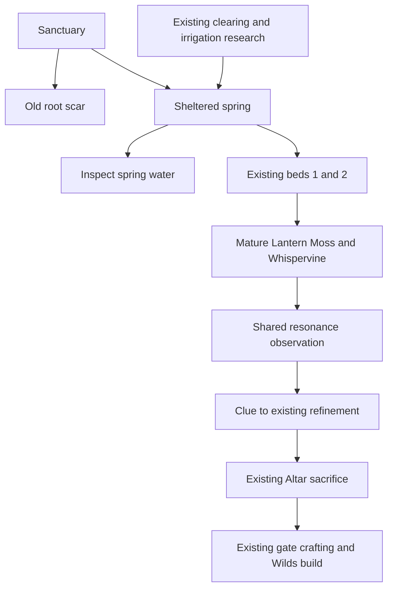

# Sheltered spring plant relationships and Garden animation

Completed 2026-11-10: G-02 and G-03. The first complete Garden experiment now uses existing research, cultivation, the Altar and gate crafting. G-06 has a cosmetic foundation; its broader responses to care/returns and the Heart remain unfinished. Next objective: G-04, one bounded crop-cycle choice.

## Player experience

1. Complete **Reaching Roots** (`clearing_1`) and **Root Irrigation** (`irrigation`) through existing Heart research. The spring appears inside the clearing, beside the first two planting beds on the right. Inspection has no additional Knowledge/material fee.
2. Inspect the spring with the configured Interact key. Its description recaps why the water appeared, including for a previously unlocked save or a reveal missed during an expedition.
3. Grow **Lantern Moss** and **Whispervine** to maturity in those two beds, in either order. A quiet root connection becomes inspectable between them. These beds remain universal; other species still grow normally.
4. Record the resonance to learn a clue: combine two ordinary Lantern Moss **crafting parts** in the Altar's **Plant Parts** tab. Actual ingredients must be harvested and sacrificed there. Observation does not grant an output or discover the recipe automatically.
5. Use the resulting existing refined component in the normal gate weapon slots and take that build into the Wilds. The tested path uses the current material/tag resolver, not a new Garden combat bonus.

The recorded clue stays readable after harvesting the plants. Before discovery, harvesting either required crop invalidates an outstanding observation request. If the refinement is already known, the journal gives context without extra items or Knowledge.

## Content hierarchy and module boundaries

`garden_interaction_catalog.gd` remains the single definition source: parent zone, existing technology IDs, footprint, water anchor/radius, stable `bed_1`/`bed_2` membership, observation point, species/stage condition, clue species and ambient-family budget. Catalog validation checks parentage, IDs, supported actions/visuals, real species, bed IDs and an actual refinement recipe. Published IDs are not replaced with array positions.

`garden_layout.gd` supplies eligible destinations, cached water placement, dry approach/decoration exclusions, zone-bed membership and the registered camera extent. Existing Garden scenery builders consume this adapter instead of maintaining separate spring-specific placement lists. Both the spring and existing pools avoid bed/station anchors and registered paths. Existing occupied crops never move and no free bed is created. The footprint fits the existing circular clearing; movement bounds remain unchanged.

Water remains decorative as before, with no new blocking collision. The footprint is available for later authoritative shore/navigation work; adding collision only in a local visual would be inappropriate for co-op. This slice reserves dry access routes and adds no invisible obstacle or movement protocol change.

`garden_relationships.gd` reads the host's current crops in registered beds, resolves stable species IDs and retrieves the existing Altar refinement. The original observation service handles commands, transaction rollback, duplicate/stale requests and read-only projections. Its optional projection adds clue text. No new RPC, compact combat-array slot, save namespace or reward ledger was needed.

The unchanged observation dictionary preserves unknown IDs and future fields. Existing technology completion determines place availability, so an upgraded old save reveals the spring without buying the technology again. Shared journal entries stay in the host Garden; personal class progression/familiarity and inventory stay under their existing owners.

## Cosmetic life and motion control

The Garden now has gently swaying grass/groundcover, shared water animation and a pale moth population over the spring. A new point eases into view when its conditions become available. Joining an already unlocked world establishes the presentation baseline without replaying an old reveal. Close-up names yield to the player's overhead label; the Interact prompt remains visible.

`garden_ambience.gd` owns local cosmetic populations and shader controls. The current `moth` family uses one instanced wing mesh with GPU orbit/wing motion, at most eight instances per zone, a bounded shader-motion AABB, an 11-metre visibility range and a 0.15-second CPU visibility/material refresh. It has no physics body, loot, familiarity, XP, save state or per-frame network/log output. Positions need not be identical between peers because no gameplay action targets them.

Settings → Display & aiming → **Animate Garden wind, water and fauna** toggles this layer. Turning it off hides fauna and freezes the new wind/water shader time. The preference is local and saved through existing settings. It does not change cultivation/research clocks, progression, combat, or the existing Heart/interaction feedback.

Foliage uses `garden_breeze.gdshader`; water uses `garden_water.gdshader`; moths use `garden_moth.gdshader`. The breeze weights displacement toward blade/fern tips. Tree trunks and existing character/monster rigs were not changed. These are code-authored tiny cosmetic meshes and shaders, not new Blender-rig exports.

## Research and decisions

Godot documents MultiMesh as instanced rendering with one spatial visibility bound per batch and no blend-shape support. Small local batches and explicit motion bounds fit this Garden better than a single world-sized fauna object. [Godot MultiMesh](https://docs.godotengine.org/en/stable/classes/class_multimesh.html)

Godot's vertex-animation example demonstrates shader-driven motion with instance variation. This slice applies that approach to tip-weighted foliage and moth wings/orbits. The example carries a 4.7 update notice, so the implementation was compiled and rendered locally with the installed 4.7.2 Compatibility renderer. [Vertex animation example](https://docs.godotengine.org/en/stable/tutorials/performance/vertex_animation/animating_thousands_of_fish.html)

Shader `TIME` runs independently of scene pausing. The explicit motion uniform provides a dependable local off setting rather than assuming a paused scene freezes background shaders. [Spatial shader built-ins](https://docs.godotengine.org/en/stable/tutorials/shaders/shader_reference/spatial_shader.html)

For larger future fauna, Blender's glTF export supports object transforms, pose bones and shape-key values; material/light/physics animation is not exported through that animation path. Keep water/wind materials in Godot, and author named movement clips for larger rigged creatures. Actions must be associated with objects or stashed in NLA for the default export workflow. [Blender glTF animation reference](https://docs.blender.org/manual/en/latest/addons/scene_gltf2.html)

Godot's importer supports sampling, trimming, immutable-track removal and reusable AnimationLibrary imports. Start a larger fauna template with idle/perch, takeoff, flight-loop and landing actions; verify one GLB in Godot before expanding the family. Profile the visible population rather than attaching a skeleton to every grass tuft. [Godot animation import configuration](https://docs.godotengine.org/en/stable/tutorials/assets_pipeline/importing_3d_scenes/import_configuration.html)

## Add another place or relationship

1. Add a stable child zone with existing research prerequisites, a safe footprint and existing stable bed IDs. Define optional water and a supported ambient family/budget. Check the footprint against all occupied/future beds and main stations.
2. Add an inspectable observation point under that zone using the existing observe/cue vocabulary. For a plant relationship, specify registered zone, stable species IDs, mature stage and a species with an existing refinement recipe.
3. The shared layout, conditions, command route, state/projection, inspect view and ambient family handle those definitions. New verbs, rewards, fauna families or physical collision require an explicit handler and relevant integration checks.
4. Preserve universal beds and the actual Altar payment. Never grant a recipe/item from a tooltip, animation completion or a client-only moth position.
5. Use `garden_zones`, `garden_relationships` and `garden_life` ownership in the interaction map. Specific Garden shader rules must precede the generic shader rule. Normal content edits still need import/export; they need not rewrite combat, research or networking.

## Verification and release

The first connected pass ran 12 affected suites with 74 reused. The final readability pass `20261110-124541-1787fbb2` ran 11 affected suites with 75 reused. All 36 planner self-tests passed. Full game-suite validation was not requested or run.

`garden_spring` exercises real technology research, registered water/path clearance over supported bed counts and radii, old unlocked saves, growing/harvesting, stale conditions, clue-only recording, actual Altar payment/refinement, gate installation, changed weapon attributes and entry into an expedition. It also tests local settings persistence, bounded fauna and unchanged gameplay RNG/inventory/progression.

`garden_spring_coop` uses real host/guest peers to verify host capabilities/layout, stale crop rejection, simultaneous observation, durable shared clues and late-join restoration without reward/cue replay. Existing Garden, observation, research, menu and gate suites also passed.

Packaged plan: 7 selected suites, 46 reused, plus startup/catalog/exclusion validation and real host/three-guest network smoke. The installed `Mystical Garden v0.5.2.0.exe` matches the verified staged SHA256 `cdcaec5650621cad121f2c8fba58564aecb34f045c52a17656c9aa51ac6c237d`.

Evidence: `.godot/g02-unit.log`, `.godot/g02-connected.log`, `.godot/g02-connected-final.log`, `.godot/g02-package-final.log`, `.godot/validation/runs/20261110-124541-1787fbb2/`, `.godot/validation/last-package.json`. Rendered previews `.godot/g02-spring.png`, `.godot/g02-motion.png` and `.godot/g02-clue.png` were inspected; the Compatibility render error log is empty.

The retained cleanup backup was not opened, scanned, hashed or modified. G-04 is Ready. G-06 remains In progress: foundational motion/fauna are implemented, while care/return-driven ecological and Heart responses still need their own acceptance evidence.
