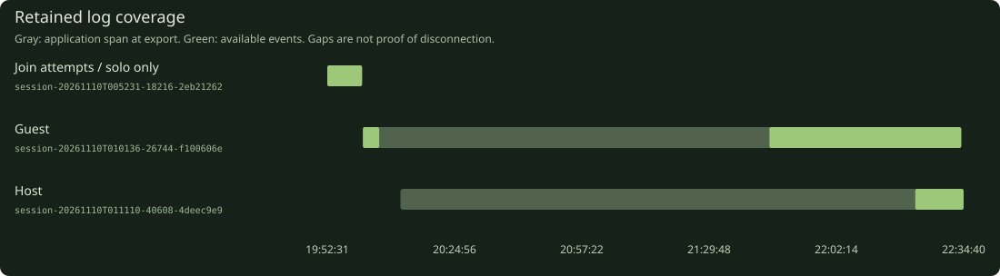

# Gameplay log analysis

## Findings

Read **13,870 events**, retained **9,290 unique events**, and removed **4,580 duplicate copies** across 21 input files. Original inputs were not modified.

- Captured builds: 1 distinct runtime fingerprints; protocols: 16. Filenames are not used to infer build identity.
- Early/later exports of the same application session were merged: `session-20261110T010136-26744-f100606e` (70, 11777). These exports are not separate connected players.
- Host samples show guest peer(s) without their own connected-client report: **1226419972**. Their health is visible from the host, but their local experience cannot be fully evaluated.
- Recorded error-level events: **0**; warning-level events: **6**. Missing/rotated history prevents treating this as proof that the full play session was error-free.
- **6 earlier join timeouts** are recorded. A timeout identifies an incomplete connection; these logs alone do not identify a specific router/firewall cause.
- Exact host/world/actor/revision checks of HP + damage sequence: **223/223 matched**, **0 mismatches**, 537 guest updates without a retained matching host sample, 0 ambiguous host revisions. Unmatched revisions are not evidence of packet loss.
- Retained host state shows **11 downs** and **9 in-Wilds revivals**; Garden restorations are counted separately below. These are partial-window totals.
- Host-retained gameplay includes **7 encounter clears**, floors 18–24, with **138 recorded kills**. This is the retained portion, not a full-run total.
- Save outcomes retained: 378 commits and 0 rollbacks. 0 action/transaction starts lack a retained ending; 1 action endings lack their retained start. Rotation/export boundaries must be checked before diagnosing interrupted handlers.

## Session coverage

Times below use the requested fixed UTC offset. Event ordering is local sequence order; clocks on different computers may differ.

| Session | Observed role | Unique events | Retained sequence | First → last retained time | Shutdown evidence |
|---|---|---:|---|---|---|
| `session-20261110T005231-18216-2eb21262` | Join attempts / solo only | 303 | 1–303 | 2026-11-09 19:52:31 -0500 → 2026-11-09 20:01:24 -0500 | normal shutdown recorded |
| `session-20261110T010136-26744-f100606e` | Guest | 4,710 | 1–11777 | 2026-11-09 20:01:36 -0500 → 2026-11-09 22:34:03 -0500 | open/unclean at export; crash not established |
| `session-20261110T011110-40608-4deec9e9` | Host | 4,277 | 34519–38795 | 2026-11-09 22:22:21 -0500 → 2026-11-09 22:34:40 -0500 | normal shutdown recorded |

`session-20261110T010136-26744-f100606e`: 0 missing leading events; internal gaps: [{"from_seq":71,"to_seq":7137}]; 0 metadata-indicated trailing events unavailable.

`session-20261110T011110-40608-4deec9e9`: 34,518 missing leading events; internal gaps: []; 0 metadata-indicated trailing events unavailable.

## Connection warnings and engine errors

| Severity | Event | Count | Message | First evidence |
|---|---|---:|---|---|
| warning | connection_rejected | 6 | Connection timed out. Check the host IP, UDP port and firewall/router access. Your character is preserved. | `session-20261110T005231-18216-2eb21262:185` |

## Network measurements

These are periodic samples of ENet’s smoothed reliable-packet estimates, not per-packet measurements or a total-loss percentage for the run. Snapshot gaps refer to the application sequence counter.

| Viewpoint → remote peer | Samples | RTT median / p95 / max (ms) | Reliable-loss estimate mean / max (%) | Observed snapshot-gap counter increase | FPS median / min |
|---|---:|---|---|---:|---|
| `session-20261110T010136-26744-f100606e` (Guest) → 1 | 1437 | 82.00 / 93.00 / 149.00 | 0.07 / 0.14 | 2565 | 111.00 / 59.00 |
| `session-20261110T011110-40608-4deec9e9` (Host) → 1226419972 | 345 | 57.00 / 67.00 / 131.00 | 0.43 / 0.71 | — | 60.00 / 44.00 |
| `session-20261110T011110-40608-4deec9e9` (Host) → 1655499315 | 344 | 79.00 / 92.00 / 172.00 | 0.94 / 1.43 | — | 60.00 / 44.00 |

## Retained host combat and generation

Generation-to-clear time includes combat, looting and any delay before the clear was recorded. It is not a measure of pure attack DPS. Garden/reset generation (seed 0) is excluded from the generation-time statistics.

| Floor | Biome | Cycle | Recorded kills | Generation → clear (s) | Clear time | Evidence |
|---:|---:|---:|---:|---:|---|---|
| 18 | 2 | 0 | 20 | — | 2026-11-09 22:22:27 -0500 | `session-20261110T011110-40608-4deec9e9:34606` |
| 19 | 0 | 1 | 19 | 50.00 | 2026-11-09 22:23:59 -0500 | `session-20261110T011110-40608-4deec9e9:35224` |
| 20 | 0 | 1 | 19 | 51.00 | 2026-11-09 22:25:36 -0500 | `session-20261110T011110-40608-4deec9e9:35627` |
| 21 | 0 | 1 | 20 | 108.00 | 2026-11-09 22:27:44 -0500 | `session-20261110T011110-40608-4deec9e9:36255` |
| 22 | 0 | 1 | 20 | 53.00 | 2026-11-09 22:28:58 -0500 | `session-20261110T011110-40608-4deec9e9:37167` |
| 23 | 0 | 1 | 20 | 52.00 | 2026-11-09 22:29:57 -0500 | `session-20261110T011110-40608-4deec9e9:37842` |
| 24 | 0 | 1 | 20 | 100.00 | 2026-11-09 22:31:45 -0500 | `session-20261110T011110-40608-4deec9e9:38469` |

`session-20261110T005231-18216-2eb21262` wilderness generation: n=1, median 252.25 ms, p95 252.25 ms, max 252.25 ms. A generation duration is not proof of a visible hitch or network latency.

`session-20261110T010136-26744-f100606e` wilderness generation: n=36, median 304.64 ms, p95 323.03 ms, max 326.89 ms. A generation duration is not proof of a visible hitch or network latency.

`session-20261110T011110-40608-4deec9e9` wilderness generation: n=6, median 221.27 ms, p95 229.69 ms, max 231.28 ms. A generation duration is not proof of a visible hitch or network latency.

## Gameplay interactions

Counts are log events, not necessarily successful casts or completed research. Client requests and host execution are kept separate.

| Session | Skill requests | Damage events | Incoming damage recorded | Upgrade records | Graft rolls |
|---|---:|---:|---:|---:|---:|
| `session-20261110T005231-18216-2eb21262` | 4 | 0 | 0 | 0 | 0 |
| `session-20261110T010136-26744-f100606e` | 0 | 0 | 0 | 0 | 0 |
| `session-20261110T011110-40608-4deec9e9` | 640 | 187 | 187 | 6 | 0 |

## Party survival in the retained host window

These are observed transitions, not full-session totals. Revivals require a fallen→alive transition with the logged two-point maximum-health sacrifice. Garden resets are counted separately.

| Actor | Classes observed | Incoming damage events / amount | Downs | In-Wilds revivals | Garden restorations |
|---|---|---|---:|---:|---:|
| Guest `1226419972` | Reaper | 77 / 77 | 5 | 4 | 1 |
| Guest `1655499315` | Weaver | 67 / 67 | 0 | 0 | 0 |
| Host `1` | Ranger | 43 / 43 | 6 | 5 | 1 |

Differences in down counts may reflect build, player choices, healing or accumulated revival penalties. This partial sample does not establish that a class is overpowered or underpowered.

## Upgrades and research

| Upgrade | Actor | Floor | Cost | Evidence |
|---|---|---:|---:|---|
| reach | 1226419972 | 18 | 6 | `session-20261110T011110-40608-4deec9e9:34639` |
| class_2_1 | 1 | 18 | 8 | `session-20261110T011110-40608-4deec9e9:34648` |
| weapon_1_1 | 1655499315 | 18 | 10 | `session-20261110T011110-40608-4deec9e9:34659` |
| reaper_charge | 1226419972 | 21 | 9 | `session-20261110T011110-40608-4deec9e9:36284` |
| class_2_0 | 1 | 21 | 8 | `session-20261110T011110-40608-4deec9e9:36292` |
| weaver_link | 1655499315 | 21 | 9 | `session-20261110T011110-40608-4deec9e9:36301` |

`session-20261110T005231-18216-2eb21262`: 11 Garden/research state records; active node IDs observed: none. These are sampled state changes, not a count of completed research projects.

`session-20261110T010136-26744-f100606e`: 145 Garden/research state records; active node IDs observed: irrigation, nursery. These are sampled state changes, not a count of completed research projects.

`session-20261110T011110-40608-4deec9e9`: 23 Garden/research state records; active node IDs observed: nursery. These are sampled state changes, not a count of completed research projects.

## Player markers

No issue markers were present in the retained files.

## Next investigations

1. Collect the missing active guest’s report to complete three-way comparisons. Export promptly after a problem; rolling logs discard older events.
2. Add an issue marker at the moment of a symptom. Include what the player saw, the skill/weapon used, and whether the host saw it too.
3. For suspected health desync, inspect the exact revision matches/mismatches in `summary.json`; do not compare nearby timestamps alone.
4. Improve long-playtest coverage: routine action records have rotated away the beginning of this host session. Consider compact full-run summaries or archiving each expedition before increasing trace volume.
5. Treat generation timing and network estimates as leads. Reproduce a symptom before changing balance, networking or procedural generation.

## Analysis limitations

- A report exported while the game is running is not proof of a crash. Missing clean-exit metadata is intentionally reported as unknown/open.
- Rotated chunks and unavailable viewpoints limit conclusions. A lack of recorded errors is not proof that none occurred outside coverage.
- Health comparisons cover HP and damage sequence, not every max-health, shielding or presentation field. Incoming damage records do not measure weapon DPS or verify wind-up bonuses.
- Host snapshot-gap counters are not applicable because the host does not receive its own world snapshots.
- Shared revision comparisons avoid cross-PC clock assumptions; this report does not estimate one-way latency or precisely align clocks.
- The script is read-only toward inputs. It emits data and evidence references; it does not change the game, saves or original logs.
